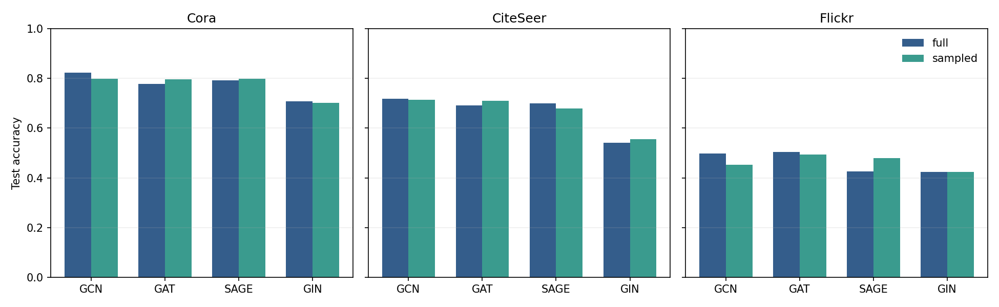
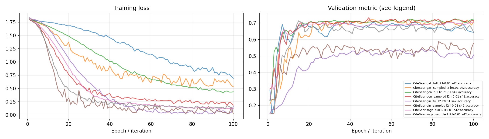
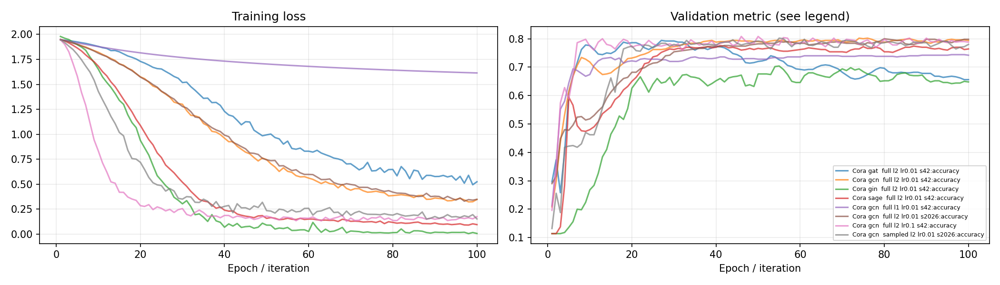
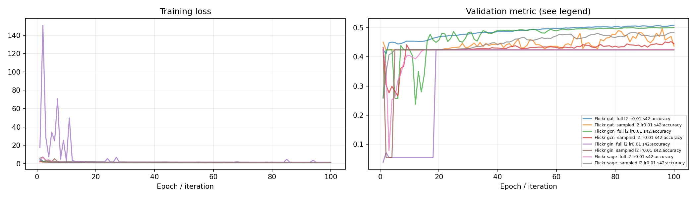
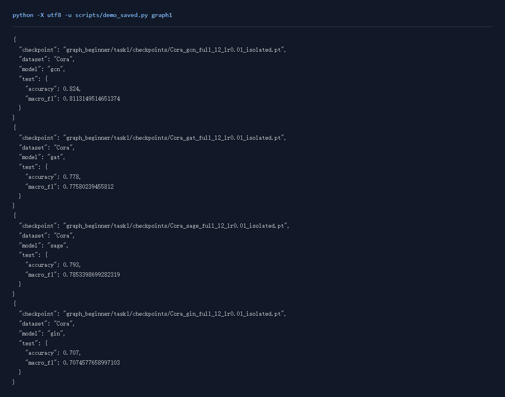

# Graph任务1：节点分类

## 一、实验环境与条件

Windows 11，Python 3.11，RTX 3050 Ti Laptop 4GB。PyTorch 2.6.0+cu124；图任务使用PyG 2.6.1。NumPy分类运行在CPU，神经网络训练使用CUDA。种子默认为42。完整版本与下载来源见[环境说明](../../学习报告/实验环境.md)。

## 二、实验方法与过程

采用PyG，在Cora、CiteSeer、Flickr上训练GCN、GAT、GraphSAGE和GIN。每个模型分别使用全图与RandomNodeLoader随机诱导子图，保留官方节点mask，共24组。结果表的节点数表示图结构规模，训练损失只使用train_mask中的标签。Cora补学习率和层数对照，以及GCN的多种子实验。新增计时实验依次运行，GPU训练保持串行。

### 实现与知识点

GCN对邻居特征做含度归一化的传播；GAT学习邻居注意力；GraphSAGE分别处理自身与邻居聚合；GIN用求和聚合加MLP，并学习自身项的系数。四者共享层数、隐藏维度与训练流程，便于观察差异。

Cora/CiteSeer采用公开mask；Flickr保留官方role划分。节点分类是transductive设置：训练可以使用全图无标签结构，但损失只能用train_mask对应标签。验证集选择轮次，测试集最后评估。

RandomNodeLoader是框架的随机诱导子图分区。训练子图由随机分区的节点诱导得到，跨分区边在本轮被移除。分区降低单次显存占用，但可能损失邻居信息。层数增加也可能出现过平滑：不同节点表示逐渐接近。

### 复现命令

在项目根目录运行：

```powershell
.\.venv\Scripts\python.exe graph_beginner/task1/code/train.py --dataset Cora --model gcn --mode full --epochs 100
.\.venv\Scripts\python.exe scripts/run_matrix.py graph-small
.\.venv\Scripts\python.exe scripts/run_matrix.py graph-flickr
```

全部新增对照可通过 `python scripts/quality_runs.py`、`python scripts/quality_extra_runs.py` 与 `python scripts/quality_followup_runs.py` 顺序复现，结果和权重完整的成功命令会按日志跳过。

## 三、实验结果及分析

| 实验配置 | 训练规模 | 轮数 | 验证指标 | 测试指标 | 运行时间 / s |
|---|---:|---:|---|---|---:|
| [CiteSeer_gat_full_l2_lr0.01_isolated](results/CiteSeer_gat_full_l2_lr0.01_isolated.json) | 3327节点 | 100 | accuracy=0.7060 | accuracy=0.6910; macro_f1=0.6534 | 2.3 |
| [CiteSeer_gat_sampled_l2_lr0.01_isolated](results/CiteSeer_gat_sampled_l2_lr0.01_isolated.json) | 3327节点 | 100 | accuracy=0.7220 | accuracy=0.7100; macro_f1=0.6724 | 5.6 |
| [CiteSeer_gcn_full_l2_lr0.01_isolated](results/CiteSeer_gcn_full_l2_lr0.01_isolated.json) | 3327节点 | 100 | accuracy=0.7260 | accuracy=0.7190; macro_f1=0.6835 | 1.7 |
| [CiteSeer_gcn_sampled_l2_lr0.01_isolated](results/CiteSeer_gcn_sampled_l2_lr0.01_isolated.json) | 3327节点 | 100 | accuracy=0.7320 | accuracy=0.7130; macro_f1=0.6788 | 4.8 |
| [CiteSeer_gin_full_l2_lr0.01_isolated](results/CiteSeer_gin_full_l2_lr0.01_isolated.json) | 3327节点 | 100 | accuracy=0.5420 | accuracy=0.5420; macro_f1=0.5070 | 2.5 |
| [CiteSeer_gin_sampled_l2_lr0.01_isolated](results/CiteSeer_gin_sampled_l2_lr0.01_isolated.json) | 3327节点 | 100 | accuracy=0.5880 | accuracy=0.5550; macro_f1=0.5210 | 4.5 |
| [CiteSeer_sage_full_l2_lr0.01_isolated](results/CiteSeer_sage_full_l2_lr0.01_isolated.json) | 3327节点 | 100 | accuracy=0.7040 | accuracy=0.7000; macro_f1=0.6726 | 2.1 |
| [CiteSeer_sage_sampled_l2_lr0.01_isolated](results/CiteSeer_sage_sampled_l2_lr0.01_isolated.json) | 3327节点 | 100 | accuracy=0.7140 | accuracy=0.6790; macro_f1=0.6388 | 4.4 |
| [Cora_gat_full_l2_lr0.01_isolated](results/Cora_gat_full_l2_lr0.01_isolated.json) | 2708节点 | 100 | accuracy=0.7940 | accuracy=0.7780; macro_f1=0.7758 | 2.0 |
| [Cora_gat_sampled_l2_lr0.01_isolated](results/Cora_gat_sampled_l2_lr0.01_isolated.json) | 2708节点 | 100 | accuracy=0.7960 | accuracy=0.7970; macro_f1=0.7898 | 4.9 |
| [Cora_gcn_full_l2_lr0.01_isolated](results/Cora_gcn_full_l2_lr0.01_isolated.json) | 2708节点 | 100 | accuracy=0.8020 | accuracy=0.8240; macro_f1=0.8113 | 1.6 |
| [Cora_gcn_sampled_l2_lr0.01_isolated](results/Cora_gcn_sampled_l2_lr0.01_isolated.json) | 2708节点 | 100 | accuracy=0.8040 | accuracy=0.7980; macro_f1=0.7917 | 3.7 |
| [Cora_gin_full_l2_lr0.01_isolated](results/Cora_gin_full_l2_lr0.01_isolated.json) | 2708节点 | 100 | accuracy=0.7040 | accuracy=0.7070; macro_f1=0.7075 | 1.8 |
| [Cora_gin_sampled_l2_lr0.01_isolated](results/Cora_gin_sampled_l2_lr0.01_isolated.json) | 2708节点 | 100 | accuracy=0.6780 | accuracy=0.7020; macro_f1=0.6880 | 4.2 |
| [Cora_sage_full_l2_lr0.01_isolated](results/Cora_sage_full_l2_lr0.01_isolated.json) | 2708节点 | 100 | accuracy=0.7760 | accuracy=0.7930; macro_f1=0.7853 | 1.7 |
| [Cora_sage_sampled_l2_lr0.01_isolated](results/Cora_sage_sampled_l2_lr0.01_isolated.json) | 2708节点 | 100 | accuracy=0.7760 | accuracy=0.7980; macro_f1=0.7854 | 3.7 |
| [Flickr_gat_full_l2_lr0.01_isolated](results/Flickr_gat_full_l2_lr0.01_isolated.json) | 89250节点 | 100 | accuracy=0.5079 | accuracy=0.5046; macro_f1=0.1669 | 6.3 |
| [Flickr_gat_sampled_l2_lr0.01_isolated](results/Flickr_gat_sampled_l2_lr0.01_isolated.json) | 89250节点 | 100 | accuracy=0.4966 | accuracy=0.4942; macro_f1=0.1591 | 13.9 |
| [Flickr_gcn_full_l2_lr0.01_isolated](results/Flickr_gcn_full_l2_lr0.01_isolated.json) | 89250节点 | 100 | accuracy=0.5003 | accuracy=0.4988; macro_f1=0.1660 | 3.9 |
| [Flickr_gcn_sampled_l2_lr0.01_isolated](results/Flickr_gcn_sampled_l2_lr0.01_isolated.json) | 89250节点 | 100 | accuracy=0.4522 | accuracy=0.4526; macro_f1=0.1193 | 13.0 |
| [Flickr_gin_full_l2_lr0.01_isolated](results/Flickr_gin_full_l2_lr0.01_isolated.json) | 89250节点 | 100 | accuracy=0.4239 | accuracy=0.4234; macro_f1=0.0850 | 22.0 |
| [Flickr_gin_sampled_l2_lr0.01_isolated](results/Flickr_gin_sampled_l2_lr0.01_isolated.json) | 89250节点 | 100 | accuracy=0.4239 | accuracy=0.4234; macro_f1=0.0850 | 19.0 |
| [Flickr_sage_full_l2_lr0.01_isolated](results/Flickr_sage_full_l2_lr0.01_isolated.json) | 89250节点 | 100 | accuracy=0.4257 | accuracy=0.4253; macro_f1=0.0913 | 13.3 |
| [Flickr_sage_sampled_l2_lr0.01_isolated](results/Flickr_sage_sampled_l2_lr0.01_isolated.json) | 89250节点 | 100 | accuracy=0.4832 | accuracy=0.4799; macro_f1=0.1545 | 18.7 |
| [Cora_gcn_full_l1_lr0.01_ablation](results/Cora_gcn_full_l1_lr0.01_ablation.json) | 2708节点 | 100 | accuracy=0.7440 | accuracy=0.7720; macro_f1=0.7606 | 1.3 |
| [Cora_gcn_full_l2_lr0.001_ablation](results/Cora_gcn_full_l2_lr0.001_ablation.json) | 2708节点 | 100 | accuracy=0.7720 | accuracy=0.7550; macro_f1=0.7435 | 1.4 |
| [Cora_gcn_full_l2_lr0.01_seed2026](results/Cora_gcn_full_l2_lr0.01_seed2026.json) | 2708节点 | 100 | accuracy=0.8000 | accuracy=0.8150; macro_f1=0.8034 | 1.4 |
| [Cora_gcn_full_l2_lr0.01_seed7](results/Cora_gcn_full_l2_lr0.01_seed7.json) | 2708节点 | 100 | accuracy=0.8020 | accuracy=0.8160; macro_f1=0.8049 | 1.5 |
| [Cora_gcn_full_l2_lr0.1_ablation](results/Cora_gcn_full_l2_lr0.1_ablation.json) | 2708节点 | 100 | accuracy=0.8080 | accuracy=0.8140; macro_f1=0.8032 | 1.5 |
| [Cora_gcn_full_l3_lr0.01_ablation](results/Cora_gcn_full_l3_lr0.01_ablation.json) | 2708节点 | 100 | accuracy=0.7920 | accuracy=0.8020; macro_f1=0.7899 | 1.7 |
| [Cora_gcn_sampled_l2_lr0.01_seed2026](results/Cora_gcn_sampled_l2_lr0.01_seed2026.json) | 2708节点 | 100 | accuracy=0.8020 | accuracy=0.8100; macro_f1=0.8006 | 3.4 |
| [Cora_gcn_sampled_l2_lr0.01_seed7](results/Cora_gcn_sampled_l2_lr0.01_seed7.json) | 2708节点 | 100 | accuracy=0.8000 | accuracy=0.8100; macro_f1=0.7957 | 4.0 |

CiteSeer按验证集选择的配置为 `CiteSeer_gcn_sampled_l2_lr0.01_isolated`，accuracy=0.7320，测试结果为 accuracy=0.7130; macro_f1=0.6788。
Cora按验证集选择的配置为 `Cora_gcn_full_l2_lr0.1_ablation`，accuracy=0.8080，测试结果为 accuracy=0.8140; macro_f1=0.8032。
Flickr按验证集选择的配置为 `Flickr_gat_full_l2_lr0.01_isolated`，accuracy=0.5079，测试结果为 accuracy=0.5046; macro_f1=0.1669。

训练耗时在CUDA同步后记录。上表的运行时间从实验记录建立时开始，包含训练、验证、测试和保存，数据下载与准备另记在运行日志中。下表倍率为全图训练时间除以另一模式训练时间，便于同时观察速度和指标。

| 数据 / 模型 / 池化 | full / s | sampled 或 batch / s | 时间倍率 | full 测试 | 另一模式测试 |
|---|---:|---:|---:|---|---|
| CiteSeer / gat / l2 lr0.01 | 1.372 | 4.797 | 0.286 | accuracy=0.6910; macro_f1=0.6534 | accuracy=0.7100; macro_f1=0.6724 |
| CiteSeer / gcn / l2 lr0.01 | 0.982 | 4.027 | 0.244 | accuracy=0.7190; macro_f1=0.6835 | accuracy=0.7130; macro_f1=0.6788 |
| CiteSeer / gin / l2 lr0.01 | 1.365 | 3.435 | 0.397 | accuracy=0.5420; macro_f1=0.5070 | accuracy=0.5550; macro_f1=0.5210 |
| CiteSeer / sage / l2 lr0.01 | 1.115 | 3.411 | 0.327 | accuracy=0.7000; macro_f1=0.6726 | accuracy=0.6790; macro_f1=0.6388 |
| Cora / gat / l2 lr0.01 | 1.247 | 4.146 | 0.301 | accuracy=0.7780; macro_f1=0.7758 | accuracy=0.7970; macro_f1=0.7898 |
| Cora / gcn / l2 lr0.01 | 0.919 | 3.031 | 0.303 | accuracy=0.8240; macro_f1=0.8113 | accuracy=0.7980; macro_f1=0.7917 |
| Cora / gin / l2 lr0.01 | 1.010 | 3.351 | 0.301 | accuracy=0.7070; macro_f1=0.7075 | accuracy=0.7020; macro_f1=0.6880 |
| Cora / sage / l2 lr0.01 | 0.930 | 2.945 | 0.316 | accuracy=0.7930; macro_f1=0.7853 | accuracy=0.7980; macro_f1=0.7854 |
| Flickr / gat / l2 lr0.01 | 3.938 | 11.545 | 0.341 | accuracy=0.5046; macro_f1=0.1669 | accuracy=0.4942; macro_f1=0.1591 |
| Flickr / gcn / l2 lr0.01 | 2.072 | 11.348 | 0.183 | accuracy=0.4988; macro_f1=0.1660 | accuracy=0.4526; macro_f1=0.1193 |
| Flickr / gin / l2 lr0.01 | 11.197 | 12.302 | 0.910 | accuracy=0.4234; macro_f1=0.0850 | accuracy=0.4234; macro_f1=0.0850 |
| Flickr / sage / l2 lr0.01 | 6.671 | 12.080 | 0.552 | accuracy=0.4253; macro_f1=0.0913 | accuracy=0.4799; macro_f1=0.1545 |
Flickr官方标签划分为训练44,625、验证22,312、测试22,313个节点。训练集中最多的类别为6，固定预测该类的测试准确率为0.4234。类别分布偏向少数大类，因此结合macro-F1观察各类识别情况。
### Cora GCN多种子结果

| 模式 | 种子 | 测试accuracy均值 | 标准差 |
|---|---|---:|---:|
| full | 42, 2026, 7 | 0.8183 | 0.0049 |
| sampled | 42, 2026, 7 | 0.8060 | 0.0069 |
三个种子保持划分和模型配置一致，用均值与标准差观察初始化和训练顺序带来的波动。

### 层数与学习率

参数对照保持数据划分、模型种类和训练模式一致，分别调整层数或学习率。下表同时列出默认配置，验证分数用于选优，测试分数用于观察留出效果。

| 数据 / 模型 | 层数 | 学习率 | 验证分数 | 测试分数 |
|---|---:|---:|---:|---:|
| Cora / GCN | 2 | 0.001 | 0.7720 | 0.7550 |
| Cora / GCN | 1 | 0.01 | 0.7440 | 0.7720 |
| Cora / GCN | 2 | 0.01 | 0.8020 | 0.8240 |
| Cora / GCN | 3 | 0.01 | 0.7920 | 0.8020 |
| Cora / GCN | 2 | 0.1 | 0.8080 | 0.8140 |

Cora的层数对照：1层测试accuracy=0.7720、2层测试accuracy=0.8240、3层测试accuracy=0.8020。学习率对照：lr=0.001时为0.7550、lr=0.01时为0.8240、lr=0.1时为0.8140。

层数增加会扩大节点接收信息的范围，也增加连续聚合和优化的难度；学习率同时影响下降速度与验证波动。结果结合曲线判断，在当前划分上选择验证分数较好的配置。

### 测试指标对照



### 训练曲线







### 实际运行截图

以下为加载保存参数并运行留出样例的本地页面原始截屏；完整测试指标见上表。



[原始输出](../../学习报告/运行截图/graph1.txt) · [执行记录](../../学习报告/运行截图/graph1.json)

## 四、遇到的问题及处理情况

Flickr从国内可访问的数据源恢复，保留原始role划分。RandomNodeLoader会移除跨分区边，采样结果结合指标、时间和显存分析。早期并发记录留作历史，正式计时采用后续串行实验。
