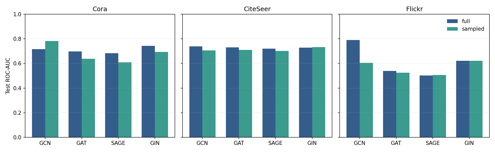
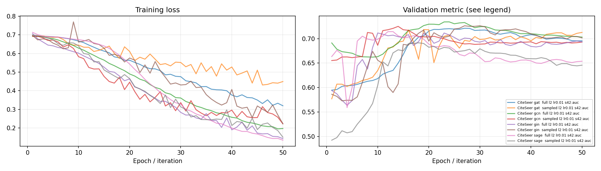
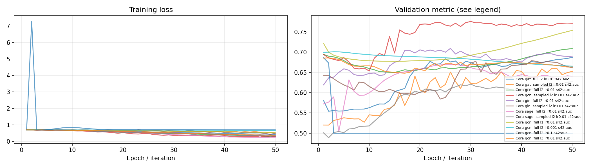
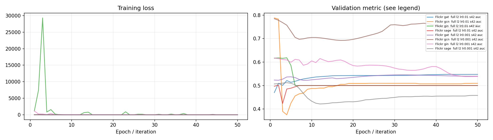
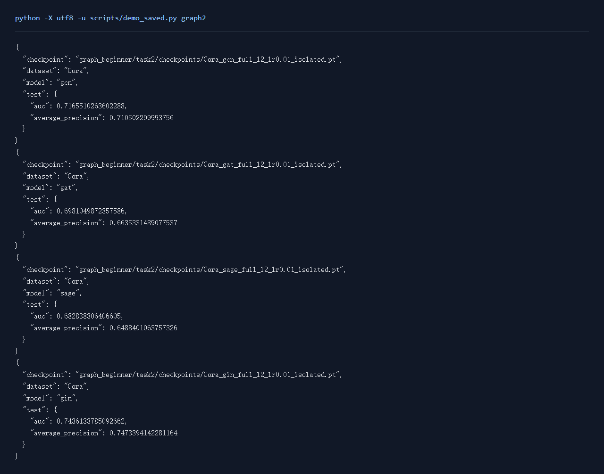

# Graph任务2：链路预测

## 一、实验环境与条件

Windows 11，Python 3.11，RTX 3050 Ti Laptop 4GB。PyTorch 2.6.0+cu124；图任务使用PyG 2.6.1。NumPy分类运行在CPU，神经网络训练使用CUDA。种子默认为42。完整版本与下载来源见[环境说明](../../学习报告/实验环境.md)。

## 二、实验方法与过程

用RandomLinkSplit将边划为10%验证、10%测试，训练正边中的20%单独作监督边。负样本在所有正边之外采样，正负约1:1。四种GNN产生节点表示，内积解码边分数，二元交叉熵训练。在三个数据集上比较全图与框架子图采样，共24组，并补Cora的学习率与层数对照。

### 实现与知识点

编码器产生节点向量z，边分数为 `z_u dot z_v`，二元交叉熵区分真实边和负样本。ROC-AUC评价排序区分能力，AP更关注正例召回精度。负例比例会影响AP，比较时应保留相同设置。

RandomLinkSplit把边分为训练、验证和测试，20%的训练正边额外与消息传递边分离。训练图中没有验证/测试正边；验证只用允许的训练结构，测试按框架标准可利用训练及验证消息边。负例由框架从所有正边之外取，避免把留出正边错当负例。

采样时把全局节点ID映射到局部ID，只保留两端都在当前分区的监督边。采样训练每轮监督边数减少，实际数量记录在JSON中，结果结合保留的图结构与监督量一起分析。

### 复现命令

在项目根目录运行：

```powershell
.\.venv\Scripts\python.exe graph_beginner/task2/code/train.py --dataset Cora --model sage --mode sampled --epochs 50
.\.venv\Scripts\python.exe scripts/run_matrix.py graph-flickr
```

全部新增对照可通过 `python scripts/quality_runs.py`、`python scripts/quality_extra_runs.py` 与 `python scripts/quality_followup_runs.py` 顺序复现，结果和权重完整的成功命令会按日志跳过。

## 三、实验结果及分析

| 实验配置 | 训练规模 | 轮数 | 验证指标 | 测试指标 | 运行时间 / s |
|---|---:|---:|---|---|---:|
| [CiteSeer_gat_full_l2_lr0.01_isolated](results/CiteSeer_gat_full_l2_lr0.01_isolated.json) | 3327节点 | 50 | auc=0.7212 | auc=0.7295; average_precision=0.7344 | 1.1 |
| [CiteSeer_gat_sampled_l2_lr0.01_isolated](results/CiteSeer_gat_sampled_l2_lr0.01_isolated.json) | 3327节点 | 50 | auc=0.7185 | auc=0.7095; average_precision=0.7257 | 2.7 |
| [CiteSeer_gcn_full_l2_lr0.01_isolated](results/CiteSeer_gcn_full_l2_lr0.01_isolated.json) | 3327节点 | 50 | auc=0.7342 | auc=0.7396; average_precision=0.7464 | 0.9 |
| [CiteSeer_gcn_sampled_l2_lr0.01_isolated](results/CiteSeer_gcn_sampled_l2_lr0.01_isolated.json) | 3327节点 | 50 | auc=0.7250 | auc=0.7065; average_precision=0.7331 | 2.7 |
| [CiteSeer_gin_full_l2_lr0.01_isolated](results/CiteSeer_gin_full_l2_lr0.01_isolated.json) | 3327节点 | 50 | auc=0.7116 | auc=0.7276; average_precision=0.7539 | 1.2 |
| [CiteSeer_gin_sampled_l2_lr0.01_isolated](results/CiteSeer_gin_sampled_l2_lr0.01_isolated.json) | 3327节点 | 50 | auc=0.7263 | auc=0.7334; average_precision=0.7510 | 2.4 |
| [CiteSeer_sage_full_l2_lr0.01_isolated](results/CiteSeer_sage_full_l2_lr0.01_isolated.json) | 3327节点 | 50 | auc=0.7143 | auc=0.7198; average_precision=0.7233 | 1.1 |
| [CiteSeer_sage_sampled_l2_lr0.01_isolated](results/CiteSeer_sage_sampled_l2_lr0.01_isolated.json) | 3327节点 | 50 | auc=0.6914 | auc=0.7026; average_precision=0.7211 | 2.3 |
| [Cora_gat_full_l2_lr0.01_isolated](results/Cora_gat_full_l2_lr0.01_isolated.json) | 2708节点 | 50 | auc=0.6872 | auc=0.6981; average_precision=0.6635 | 1.1 |
| [Cora_gat_sampled_l2_lr0.01_isolated](results/Cora_gat_sampled_l2_lr0.01_isolated.json) | 2708节点 | 50 | auc=0.6601 | auc=0.6380; average_precision=0.6180 | 2.5 |
| [Cora_gcn_full_l2_lr0.01_isolated](results/Cora_gcn_full_l2_lr0.01_isolated.json) | 2708节点 | 50 | auc=0.7089 | auc=0.7166; average_precision=0.7105 | 1.3 |
| [Cora_gcn_sampled_l2_lr0.01_isolated](results/Cora_gcn_sampled_l2_lr0.01_isolated.json) | 2708节点 | 50 | auc=0.7757 | auc=0.7822; average_precision=0.7701 | 1.9 |
| [Cora_gin_full_l2_lr0.01_isolated](results/Cora_gin_full_l2_lr0.01_isolated.json) | 2708节点 | 50 | auc=0.7093 | auc=0.7436; average_precision=0.7473 | 0.8 |
| [Cora_gin_sampled_l2_lr0.01_isolated](results/Cora_gin_sampled_l2_lr0.01_isolated.json) | 2708节点 | 50 | auc=0.6791 | auc=0.6933; average_precision=0.7053 | 1.8 |
| [Cora_sage_full_l2_lr0.01_isolated](results/Cora_sage_full_l2_lr0.01_isolated.json) | 2708节点 | 50 | auc=0.6703 | auc=0.6828; average_precision=0.6488 | 0.8 |
| [Cora_sage_sampled_l2_lr0.01_isolated](results/Cora_sage_sampled_l2_lr0.01_isolated.json) | 2708节点 | 50 | auc=0.6268 | auc=0.6081; average_precision=0.6099 | 1.8 |
| [Flickr_gat_full_l2_lr0.01_isolated](results/Flickr_gat_full_l2_lr0.01_isolated.json) | 89250节点 | 50 | auc=0.5475 | auc=0.5400; average_precision=0.4900 | 4.5 |
| [Flickr_gat_sampled_l2_lr0.01_isolated](results/Flickr_gat_sampled_l2_lr0.01_isolated.json) | 89250节点 | 50 | auc=0.5299 | auc=0.5241; average_precision=0.4871 | 8.1 |
| [Flickr_gcn_full_l2_lr0.01_isolated](results/Flickr_gcn_full_l2_lr0.01_isolated.json) | 89250节点 | 50 | auc=0.7883 | auc=0.7896; average_precision=0.8197 | 2.7 |
| [Flickr_gcn_sampled_l2_lr0.01_isolated](results/Flickr_gcn_sampled_l2_lr0.01_isolated.json) | 89250节点 | 50 | auc=0.6022 | auc=0.6049; average_precision=0.5898 | 6.9 |
| [Flickr_gin_full_l2_lr0.01_isolated](results/Flickr_gin_full_l2_lr0.01_isolated.json) | 89250节点 | 50 | auc=0.6182 | auc=0.6218; average_precision=0.6478 | 7.0 |
| [Flickr_gin_sampled_l2_lr0.01_isolated](results/Flickr_gin_sampled_l2_lr0.01_isolated.json) | 89250节点 | 50 | auc=0.6176 | auc=0.6222; average_precision=0.6490 | 9.4 |
| [Flickr_sage_full_l2_lr0.01_isolated](results/Flickr_sage_full_l2_lr0.01_isolated.json) | 89250节点 | 50 | auc=0.5019 | auc=0.5029; average_precision=0.4999 | 7.4 |
| [Flickr_sage_sampled_l2_lr0.01_isolated](results/Flickr_sage_sampled_l2_lr0.01_isolated.json) | 89250节点 | 50 | auc=0.5053 | auc=0.5053; average_precision=0.5053 | 9.4 |
| [Cora_gcn_full_l1_lr0.01_ablation](results/Cora_gcn_full_l1_lr0.01_ablation.json) | 2708节点 | 50 | auc=0.7538 | auc=0.7625; average_precision=0.7709 | 0.7 |
| [Cora_gcn_full_l2_lr0.001_ablation](results/Cora_gcn_full_l2_lr0.001_ablation.json) | 2708节点 | 50 | auc=0.7010 | auc=0.6969; average_precision=0.7194 | 0.8 |
| [Cora_gcn_full_l2_lr0.1_ablation](results/Cora_gcn_full_l2_lr0.1_ablation.json) | 2708节点 | 50 | auc=0.6864 | auc=0.6933; average_precision=0.7196 | 0.8 |
| [Cora_gcn_full_l3_lr0.01_ablation](results/Cora_gcn_full_l3_lr0.01_ablation.json) | 2708节点 | 50 | auc=0.6860 | auc=0.6949; average_precision=0.7196 | 0.9 |
| [Flickr_gat_full_l2_lr0.001_tuned](results/Flickr_gat_full_l2_lr0.001_tuned.json) | 89250节点 | 50 | auc=0.5456 | auc=0.5443; average_precision=0.5113 | 5.3 |
| [Flickr_gat_sampled_l2_lr0.001_tuned](results/Flickr_gat_sampled_l2_lr0.001_tuned.json) | 89250节点 | 50 | auc=0.5458 | auc=0.5495; average_precision=0.5381 | 9.4 |
| [Flickr_gcn_full_l2_lr0.001_tuned](results/Flickr_gcn_full_l2_lr0.001_tuned.json) | 89250节点 | 50 | auc=0.7848 | auc=0.7880; average_precision=0.8150 | 3.3 |
| [Flickr_gcn_sampled_l2_lr0.001_tuned](results/Flickr_gcn_sampled_l2_lr0.001_tuned.json) | 89250节点 | 50 | auc=0.7403 | auc=0.7449; average_precision=0.7701 | 7.8 |
| [Flickr_gin_full_l2_lr0.001_tuned](results/Flickr_gin_full_l2_lr0.001_tuned.json) | 89250节点 | 50 | auc=0.6170 | auc=0.6208; average_precision=0.6458 | 8.2 |
| [Flickr_gin_sampled_l2_lr0.001_tuned](results/Flickr_gin_sampled_l2_lr0.001_tuned.json) | 89250节点 | 50 | auc=0.8013 | auc=0.8040; average_precision=0.8321 | 9.8 |
| [Flickr_sage_full_l2_lr0.001_tuned](results/Flickr_sage_full_l2_lr0.001_tuned.json) | 89250节点 | 50 | auc=0.5122 | auc=0.5118; average_precision=0.5027 | 7.4 |
| [Flickr_sage_sampled_l2_lr0.001_tuned](results/Flickr_sage_sampled_l2_lr0.001_tuned.json) | 89250节点 | 50 | auc=0.5122 | auc=0.5100; average_precision=0.5019 | 9.2 |

CiteSeer按验证集选择的配置为 `CiteSeer_gcn_full_l2_lr0.01_isolated`，auc=0.7342，测试结果为 auc=0.7396; average_precision=0.7464。
Cora按验证集选择的配置为 `Cora_gcn_sampled_l2_lr0.01_isolated`，auc=0.7757，测试结果为 auc=0.7822; average_precision=0.7701。
Flickr按验证集选择的配置为 `Flickr_gin_sampled_l2_lr0.001_tuned`，auc=0.8013，测试结果为 auc=0.8040; average_precision=0.8321。

训练耗时在CUDA同步后记录。上表的运行时间从实验记录建立时开始，包含训练、验证、测试和保存，数据下载与准备另记在运行日志中。下表倍率为全图训练时间除以另一模式训练时间，便于同时观察速度和指标。

| 数据 / 模型 / 池化 | full / s | sampled 或 batch / s | 时间倍率 | full 测试 | 另一模式测试 |
|---|---:|---:|---:|---|---|
| CiteSeer / gat / l2 lr0.01 | 0.661 | 2.313 | 0.286 | auc=0.7295; average_precision=0.7344 | auc=0.7095; average_precision=0.7257 |
| CiteSeer / gcn / l2 lr0.01 | 0.527 | 2.262 | 0.233 | auc=0.7396; average_precision=0.7464 | auc=0.7065; average_precision=0.7331 |
| CiteSeer / gin / l2 lr0.01 | 0.636 | 1.800 | 0.353 | auc=0.7276; average_precision=0.7539 | auc=0.7334; average_precision=0.7510 |
| CiteSeer / sage / l2 lr0.01 | 0.553 | 1.724 | 0.321 | auc=0.7198; average_precision=0.7233 | auc=0.7026; average_precision=0.7211 |
| Cora / gat / l2 lr0.01 | 0.676 | 2.062 | 0.328 | auc=0.6981; average_precision=0.6635 | auc=0.6380; average_precision=0.6180 |
| Cora / gcn / l2 lr0.01 | 0.811 | 1.575 | 0.515 | auc=0.7166; average_precision=0.7105 | auc=0.7822; average_precision=0.7701 |
| Cora / gin / l2 lr0.01 | 0.476 | 1.440 | 0.331 | auc=0.7436; average_precision=0.7473 | auc=0.6933; average_precision=0.7053 |
| Cora / sage / l2 lr0.01 | 0.468 | 1.387 | 0.338 | auc=0.6828; average_precision=0.6488 | auc=0.6081; average_precision=0.6099 |
| Flickr / gat / l2 lr0.01 | 1.991 | 6.059 | 0.329 | auc=0.5400; average_precision=0.4900 | auc=0.5241; average_precision=0.4871 |
| Flickr / gcn / l2 lr0.01 | 1.134 | 5.395 | 0.210 | auc=0.7896; average_precision=0.8197 | auc=0.6049; average_precision=0.5898 |
| Flickr / gin / l2 lr0.01 | 2.899 | 5.642 | 0.514 | auc=0.6218; average_precision=0.6478 | auc=0.6222; average_precision=0.6490 |
| Flickr / sage / l2 lr0.01 | 2.705 | 5.621 | 0.481 | auc=0.5029; average_precision=0.4999 | auc=0.5053; average_precision=0.5053 |
| Flickr / gat / l2 lr0.001 | 2.192 | 6.701 | 0.327 | auc=0.5443; average_precision=0.5113 | auc=0.5495; average_precision=0.5381 |
| Flickr / gcn / l2 lr0.001 | 1.018 | 5.796 | 0.176 | auc=0.7880; average_precision=0.8150 | auc=0.7449; average_precision=0.7701 |
| Flickr / gin / l2 lr0.001 | 2.908 | 5.498 | 0.529 | auc=0.6208; average_precision=0.6458 | auc=0.8040; average_precision=0.8321 |
| Flickr / sage / l2 lr0.001 | 2.647 | 5.316 | 0.498 | auc=0.5118; average_precision=0.5027 | auc=0.5100; average_precision=0.5019 |
### 采样后的监督量

以默认两层GCN为例，每轮实际参与损失的监督边如下。RandomNodeLoader把节点分为4个诱导子图，只保留两个端点位于同一分区的监督边；时间与指标差异需要结合这一变化解释。

| 数据集 | full每轮监督边 | sampled每轮平均监督边 | 保留比例 |
|---|---:|---:|---:|
| CiteSeer | 1,456 | 360.3 | 24.75% |
| Cora | 1,688 | 424.5 | 25.15% |
| Flickr | 143,960 | 35,963.8 | 24.98% |

### 层数与学习率

参数对照保持数据划分、模型种类和训练模式一致，分别调整层数或学习率。下表同时列出默认配置，验证分数用于选优，测试分数用于观察留出效果。

| 数据 / 模型 | 层数 | 学习率 | 验证分数 | 测试分数 |
|---|---:|---:|---:|---:|
| Cora / GCN | 2 | 0.001 | 0.7010 | 0.6969 |
| Cora / GCN | 1 | 0.01 | 0.7538 | 0.7625 |
| Cora / GCN | 2 | 0.01 | 0.7089 | 0.7166 |
| Cora / GCN | 3 | 0.01 | 0.6860 | 0.6949 |
| Cora / GCN | 2 | 0.1 | 0.6864 | 0.6933 |

Cora的层数对照：1层测试auc=0.7625、2层测试auc=0.7166、3层测试auc=0.6949。学习率对照：lr=0.001时为0.6969、lr=0.01时为0.7166、lr=0.1时为0.6933。

层数增加会扩大节点接收信息的范围，也增加连续聚合和优化的难度；学习率同时影响下降速度与验证波动。结果结合曲线判断，在当前划分上选择验证分数较好的配置。

### 测试指标对照



### 训练曲线







### 实际运行截图

以下为加载保存参数并运行留出样例的本地页面原始截屏；完整测试指标见上表。



[原始输出](../../学习报告/运行截图/graph2.txt) · [执行记录](../../学习报告/运行截图/graph2.json)

## 四、遇到的问题及处理情况

采样子图需要将全局节点编号映射为局部编号，监督边仅保留两个端点都在子图中的部分；每轮实际监督边数写入JSON。训练消息边与留出正边分别管理。部分Flickr分数较大，sigmoid在浮点计算中接近1，评价改用原始logit计算AUC/AP，并重跑24组对照。另补学习率0.001的Flickr实验，查看步长对训练效果的影响。

CPU重新加载Cora的四个模型后，与CUDA逐边比较分数和划分哈希。分数在rtol=2e-5、atol=1e-6下相符，正负边之间的排序保持一致，四组AUC也一致。AP会按完全相同的分数组合阈值，float32细微差异改变了部分同类边的分组，复算差值最大约0.00000252。AP恢复检查使用1e-5的绝对容差，原始GPU指标和CPU复算指标分别保留。

[CPU/CUDA恢复核对](../../运行记录/诊断/link_reload_devices.json)
