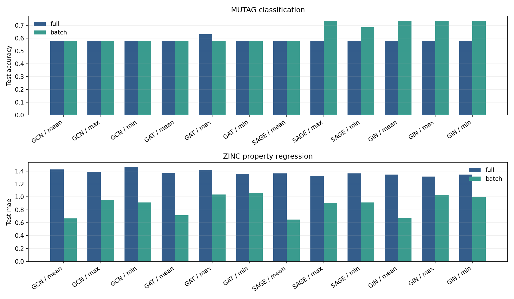
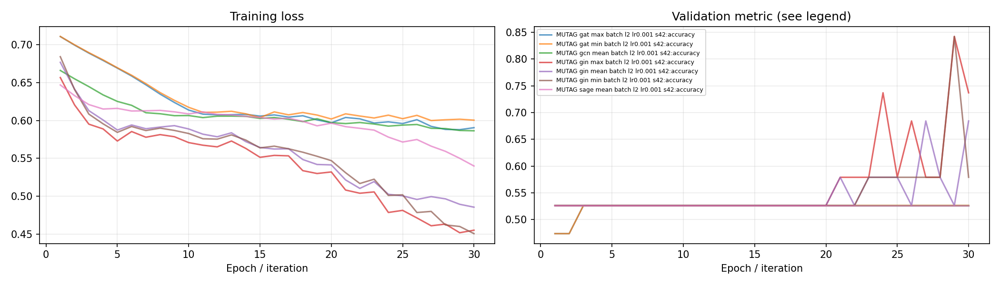
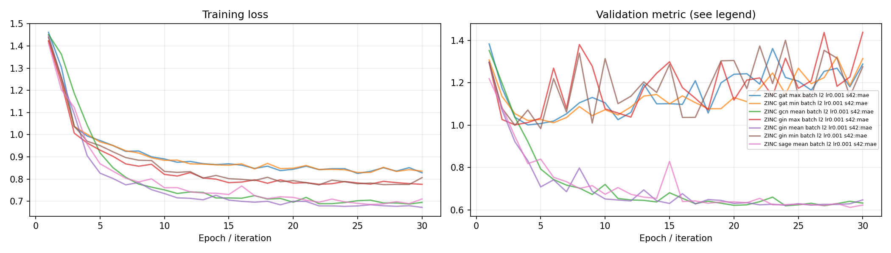
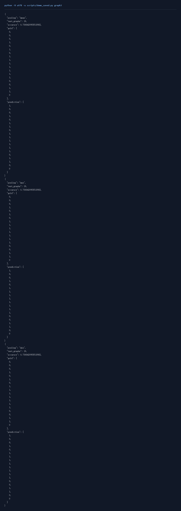

# Graph任务3：图级分类与回归

## 一、实验环境与条件

Windows 11，Python 3.11，RTX 3050 Ti Laptop 4GB。PyTorch 2.6.0+cu124；图任务使用PyG 2.6.1。NumPy分类运行在CPU，神经网络训练使用CUDA。种子默认为42。完整版本与下载来源见[环境说明](../../学习报告/实验环境.md)。

## 二、实验方法与过程

MUTAG采用TUDataset，固定种子按图划分80%、10%、10%。ZINC采用官方full划分的国内镜像，固定采样训练2,000、验证1,000、测试1,000。四种GNN分别配mean、max、min池化，再比较全批次和mini-batch，共48组。MUTAG使用交叉熵和分类指标，ZINC使用L1损失和MAE；新增GIN的层数、学习率对照。

### 实现与知识点

节点表示经过池化得到整张图的表示。mean比较平均特征，max取各通道最强响应，min取各通道最低响应。必须用batch向量区分不同图，不能将一个批次所有节点池成一张图。

MUTAG是图分类，使用cross entropy、accuracy和macro-F1。ZINC预测分子连续性质，使用L1损失及MAE，连续目标以MAE评价。其原子编号先查embedding；当前四种基本编码器使用原子类别与图连接，键类型特征可在消息函数中继续扩展。

full每轮只做一次全部训练图的更新，batch每轮做多次更新，因此同轮数的性能差异也包含优化步数差异。MUTAG测试有19张图，一张图的预测变化会使accuracy变化约5.26个百分点，可结合macro-F1观察类别识别情况。

### 复现命令

在项目根目录运行：

```powershell
.\.venv\Scripts\python.exe graph_beginner/task3/code/train.py --dataset MUTAG --model gin --pool mean --mode batch
.\.venv\Scripts\python.exe scripts/run_matrix.py graph-zinc
```

全部新增对照可通过 `python scripts/quality_runs.py`、`python scripts/quality_extra_runs.py` 与 `python scripts/quality_followup_runs.py` 顺序复现，结果和权重完整的成功命令会按日志跳过。

## 三、实验结果及分析

| 实验配置 | 训练规模 | 轮数 | 验证指标 | 测试指标 | 运行时间 / s |
|---|---:|---:|---|---|---:|
| [MUTAG_gat_max_batch_n0_lr0.001_l2](results/MUTAG_gat_max_batch_n0_lr0.001_l2.json) | 150 | 30 | score=0.5263 | accuracy=0.5789; macro_f1=0.3667 | 1.8 |
| [MUTAG_gat_max_full_n0_lr0.001_l2](results/MUTAG_gat_max_full_n0_lr0.001_l2.json) | 150 | 30 | score=0.5263 | accuracy=0.6316; macro_f1=0.4904 | 0.9 |
| [MUTAG_gat_mean_batch_n0_lr0.001_l2](results/MUTAG_gat_mean_batch_n0_lr0.001_l2.json) | 150 | 30 | score=0.5263 | accuracy=0.5789; macro_f1=0.3667 | 1.9 |
| [MUTAG_gat_mean_full_n0_lr0.001_l2](results/MUTAG_gat_mean_full_n0_lr0.001_l2.json) | 150 | 30 | score=0.5263 | accuracy=0.5789; macro_f1=0.3667 | 0.8 |
| [MUTAG_gat_min_batch_n0_lr0.001_l2](results/MUTAG_gat_min_batch_n0_lr0.001_l2.json) | 150 | 30 | score=0.5263 | accuracy=0.5789; macro_f1=0.3667 | 2.1 |
| [MUTAG_gat_min_full_n0_lr0.001_l2](results/MUTAG_gat_min_full_n0_lr0.001_l2.json) | 150 | 30 | score=0.5263 | accuracy=0.5789; macro_f1=0.5128 | 0.9 |
| [MUTAG_gcn_max_batch_n0_lr0.001_l2](results/MUTAG_gcn_max_batch_n0_lr0.001_l2.json) | 150 | 30 | score=0.5263 | accuracy=0.5789; macro_f1=0.3667 | 1.6 |
| [MUTAG_gcn_max_full_n0_lr0.001_l2](results/MUTAG_gcn_max_full_n0_lr0.001_l2.json) | 150 | 30 | score=0.5263 | accuracy=0.5789; macro_f1=0.3667 | 0.8 |
| [MUTAG_gcn_mean_batch_n0_lr0.001_l2](results/MUTAG_gcn_mean_batch_n0_lr0.001_l2.json) | 150 | 30 | score=0.5263 | accuracy=0.5789; macro_f1=0.3667 | 1.5 |
| [MUTAG_gcn_mean_full_n0_lr0.001_l2](results/MUTAG_gcn_mean_full_n0_lr0.001_l2.json) | 150 | 30 | score=0.5263 | accuracy=0.5789; macro_f1=0.3667 | 0.9 |
| [MUTAG_gcn_min_batch_n0_lr0.001_l2](results/MUTAG_gcn_min_batch_n0_lr0.001_l2.json) | 150 | 30 | score=0.5263 | accuracy=0.5789; macro_f1=0.3667 | 1.4 |
| [MUTAG_gcn_min_full_n0_lr0.001_l2](results/MUTAG_gcn_min_full_n0_lr0.001_l2.json) | 150 | 30 | score=0.5263 | accuracy=0.5789; macro_f1=0.3667 | 0.8 |
| [MUTAG_gin_max_batch_n0_lr0.001_l2](results/MUTAG_gin_max_batch_n0_lr0.001_l2.json) | 150 | 30 | score=0.8421 | accuracy=0.7368; macro_f1=0.7246 | 1.9 |
| [MUTAG_gin_max_full_n0_lr0.001_l2](results/MUTAG_gin_max_full_n0_lr0.001_l2.json) | 150 | 30 | score=0.5263 | accuracy=0.5789; macro_f1=0.3667 | 0.9 |
| [MUTAG_gin_mean_batch_n0_lr0.0001_l2_ablation](results/MUTAG_gin_mean_batch_n0_lr0.0001_l2_ablation.json) | 150 | 30 | score=0.5263 | accuracy=0.5789; macro_f1=0.3667 | 1.3 |
| [MUTAG_gin_mean_batch_n0_lr0.001_l1_ablation](results/MUTAG_gin_mean_batch_n0_lr0.001_l1_ablation.json) | 150 | 30 | score=0.5789 | accuracy=0.7368; macro_f1=0.7077 | 1.1 |
| [MUTAG_gin_mean_batch_n0_lr0.001_l2](results/MUTAG_gin_mean_batch_n0_lr0.001_l2.json) | 150 | 30 | score=0.6842 | accuracy=0.7368; macro_f1=0.7246 | 1.6 |
| [MUTAG_gin_mean_batch_n0_lr0.001_l3_ablation](results/MUTAG_gin_mean_batch_n0_lr0.001_l3_ablation.json) | 150 | 30 | score=0.7895 | accuracy=0.7895; macro_f1=0.7738 | 1.7 |
| [MUTAG_gin_mean_batch_n0_lr0.01_l2_ablation](results/MUTAG_gin_mean_batch_n0_lr0.01_l2_ablation.json) | 150 | 30 | score=0.7895 | accuracy=0.7368; macro_f1=0.7246 | 1.3 |
| [MUTAG_gin_mean_full_n0_lr0.001_l2](results/MUTAG_gin_mean_full_n0_lr0.001_l2.json) | 150 | 30 | score=0.5263 | accuracy=0.5789; macro_f1=0.3667 | 1.2 |
| [MUTAG_gin_min_batch_n0_lr0.001_l2](results/MUTAG_gin_min_batch_n0_lr0.001_l2.json) | 150 | 30 | score=0.8421 | accuracy=0.7368; macro_f1=0.7246 | 1.4 |
| [MUTAG_gin_min_full_n0_lr0.001_l2](results/MUTAG_gin_min_full_n0_lr0.001_l2.json) | 150 | 30 | score=0.5263 | accuracy=0.5789; macro_f1=0.3667 | 0.9 |
| [MUTAG_sage_max_batch_n0_lr0.001_l2](results/MUTAG_sage_max_batch_n0_lr0.001_l2.json) | 150 | 30 | score=0.6316 | accuracy=0.7368; macro_f1=0.7246 | 1.6 |
| [MUTAG_sage_max_full_n0_lr0.001_l2](results/MUTAG_sage_max_full_n0_lr0.001_l2.json) | 150 | 30 | score=0.5263 | accuracy=0.5789; macro_f1=0.3667 | 1.1 |
| [MUTAG_sage_mean_batch_n0_lr0.001_l2](results/MUTAG_sage_mean_batch_n0_lr0.001_l2.json) | 150 | 30 | score=0.5263 | accuracy=0.5789; macro_f1=0.3667 | 1.3 |
| [MUTAG_sage_mean_full_n0_lr0.001_l2](results/MUTAG_sage_mean_full_n0_lr0.001_l2.json) | 150 | 30 | score=0.5263 | accuracy=0.5789; macro_f1=0.3667 | 0.7 |
| [MUTAG_sage_min_batch_n0_lr0.001_l2](results/MUTAG_sage_min_batch_n0_lr0.001_l2.json) | 150 | 30 | score=0.6842 | accuracy=0.6842; macro_f1=0.6761 | 3.2 |
| [MUTAG_sage_min_full_n0_lr0.001_l2](results/MUTAG_sage_min_full_n0_lr0.001_l2.json) | 150 | 30 | score=0.5263 | accuracy=0.5789; macro_f1=0.3667 | 1.7 |
| [ZINC_gat_max_batch_n2000_lr0.001_l2](results/ZINC_gat_max_batch_n2000_lr0.001_l2.json) | 2000 | 30 | score=1.0008 | mae=1.0380 | 19.2 |
| [ZINC_gat_max_full_n2000_lr0.001_l2](results/ZINC_gat_max_full_n2000_lr0.001_l2.json) | 2000 | 30 | score=1.3487 | mae=1.4169 | 3.1 |
| [ZINC_gat_mean_batch_n2000_lr0.001_l2](results/ZINC_gat_mean_batch_n2000_lr0.001_l2.json) | 2000 | 30 | score=0.6653 | mae=0.7152 | 19.6 |
| [ZINC_gat_mean_full_n2000_lr0.001_l2](results/ZINC_gat_mean_full_n2000_lr0.001_l2.json) | 2000 | 30 | score=1.2951 | mae=1.3665 | 2.8 |
| [ZINC_gat_min_batch_n2000_lr0.001_l2](results/ZINC_gat_min_batch_n2000_lr0.001_l2.json) | 2000 | 30 | score=1.0110 | mae=1.0617 | 19.9 |
| [ZINC_gat_min_full_n2000_lr0.001_l2](results/ZINC_gat_min_full_n2000_lr0.001_l2.json) | 2000 | 30 | score=1.2997 | mae=1.3602 | 2.8 |
| [ZINC_gcn_max_batch_n2000_lr0.001_l2](results/ZINC_gcn_max_batch_n2000_lr0.001_l2.json) | 2000 | 30 | score=0.9099 | mae=0.9512 | 15.6 |
| [ZINC_gcn_max_full_n2000_lr0.001_l2](results/ZINC_gcn_max_full_n2000_lr0.001_l2.json) | 2000 | 30 | score=1.3219 | mae=1.3907 | 2.6 |
| [ZINC_gcn_mean_batch_n2000_lr0.001_l2](results/ZINC_gcn_mean_batch_n2000_lr0.001_l2.json) | 2000 | 30 | score=0.6191 | mae=0.6655 | 15.2 |
| [ZINC_gcn_mean_full_n2000_lr0.001_l2](results/ZINC_gcn_mean_full_n2000_lr0.001_l2.json) | 2000 | 30 | score=1.3456 | mae=1.4271 | 2.4 |
| [ZINC_gcn_min_batch_n2000_lr0.001_l2](results/ZINC_gcn_min_batch_n2000_lr0.001_l2.json) | 2000 | 30 | score=0.9017 | mae=0.9145 | 14.5 |
| [ZINC_gcn_min_full_n2000_lr0.001_l2](results/ZINC_gcn_min_full_n2000_lr0.001_l2.json) | 2000 | 30 | score=1.3891 | mae=1.4632 | 2.4 |
| [ZINC_gin_max_batch_n2000_lr0.001_l2](results/ZINC_gin_max_batch_n2000_lr0.001_l2.json) | 2000 | 30 | score=1.0012 | mae=1.0277 | 13.8 |
| [ZINC_gin_max_full_n2000_lr0.001_l2](results/ZINC_gin_max_full_n2000_lr0.001_l2.json) | 2000 | 30 | score=1.2702 | mae=1.3155 | 2.7 |
| [ZINC_gin_mean_batch_n2000_lr0.0001_l2_ablation](results/ZINC_gin_mean_batch_n2000_lr0.0001_l2_ablation.json) | 2000 | 30 | score=0.7218 | mae=0.7632 | 13.9 |
| [ZINC_gin_mean_batch_n2000_lr0.001_l1_ablation](results/ZINC_gin_mean_batch_n2000_lr0.001_l1_ablation.json) | 2000 | 30 | score=0.6081 | mae=0.6605 | 11.5 |
| [ZINC_gin_mean_batch_n2000_lr0.001_l2](results/ZINC_gin_mean_batch_n2000_lr0.001_l2.json) | 2000 | 30 | score=0.6214 | mae=0.6684 | 12.2 |
| [ZINC_gin_mean_batch_n2000_lr0.001_l3_ablation](results/ZINC_gin_mean_batch_n2000_lr0.001_l3_ablation.json) | 2000 | 30 | score=0.6142 | mae=0.6675 | 17.9 |
| [ZINC_gin_mean_batch_n2000_lr0.01_l2_ablation](results/ZINC_gin_mean_batch_n2000_lr0.01_l2_ablation.json) | 2000 | 30 | score=0.6159 | mae=0.6626 | 14.0 |
| [ZINC_gin_mean_full_n2000_lr0.001_l2](results/ZINC_gin_mean_full_n2000_lr0.001_l2.json) | 2000 | 30 | score=1.2703 | mae=1.3443 | 2.3 |
| [ZINC_gin_min_batch_n2000_lr0.001_l2](results/ZINC_gin_min_batch_n2000_lr0.001_l2.json) | 2000 | 30 | score=0.9835 | mae=0.9963 | 13.0 |
| [ZINC_gin_min_full_n2000_lr0.001_l2](results/ZINC_gin_min_full_n2000_lr0.001_l2.json) | 2000 | 30 | score=1.2958 | mae=1.3456 | 2.3 |
| [ZINC_sage_max_batch_n2000_lr0.001_l2](results/ZINC_sage_max_batch_n2000_lr0.001_l2.json) | 2000 | 30 | score=0.8844 | mae=0.9069 | 12.9 |
| [ZINC_sage_max_full_n2000_lr0.001_l2](results/ZINC_sage_max_full_n2000_lr0.001_l2.json) | 2000 | 30 | score=1.2719 | mae=1.3243 | 2.3 |
| [ZINC_sage_mean_batch_n2000_lr0.001_l2](results/ZINC_sage_mean_batch_n2000_lr0.001_l2.json) | 2000 | 30 | score=0.6115 | mae=0.6499 | 12.3 |
| [ZINC_sage_mean_full_n2000_lr0.001_l2](results/ZINC_sage_mean_full_n2000_lr0.001_l2.json) | 2000 | 30 | score=1.2823 | mae=1.3614 | 2.5 |
| [ZINC_sage_min_batch_n2000_lr0.001_l2](results/ZINC_sage_min_batch_n2000_lr0.001_l2.json) | 2000 | 30 | score=0.8953 | mae=0.9131 | 12.1 |
| [ZINC_sage_min_full_n2000_lr0.001_l2](results/ZINC_sage_min_full_n2000_lr0.001_l2.json) | 2000 | 30 | score=1.3007 | mae=1.3626 | 2.3 |

MUTAG按验证集选择的配置为 `MUTAG_gin_max_batch_n0_lr0.001_l2`，score=0.8421，测试结果为 accuracy=0.7368; macro_f1=0.7246。
ZINC按验证集选择的配置为 `ZINC_gin_mean_batch_n2000_lr0.001_l1_ablation`，score=0.6081，测试结果为 mae=0.6605。

训练耗时在CUDA同步后记录。上表的运行时间从实验记录建立时开始，包含训练、验证、测试和保存，数据下载与准备另记在运行日志中。下表倍率为全图训练时间除以另一模式训练时间，便于同时观察速度和指标。

| 数据 / 模型 / 池化 | full / s | sampled 或 batch / s | 时间倍率 | full 测试 | 另一模式测试 |
|---|---:|---:|---:|---|---|
| MUTAG / gat / max / l2 lr0.001 | 0.624 | 1.537 | 0.406 | accuracy=0.6316; macro_f1=0.4904 | accuracy=0.5789; macro_f1=0.3667 |
| MUTAG / gat / mean / l2 lr0.001 | 0.587 | 1.585 | 0.370 | accuracy=0.5789; macro_f1=0.3667 | accuracy=0.5789; macro_f1=0.3667 |
| MUTAG / gat / min / l2 lr0.001 | 0.628 | 1.767 | 0.355 | accuracy=0.5789; macro_f1=0.5128 | accuracy=0.5789; macro_f1=0.3667 |
| MUTAG / gcn / max / l2 lr0.001 | 0.568 | 1.314 | 0.432 | accuracy=0.5789; macro_f1=0.3667 | accuracy=0.5789; macro_f1=0.3667 |
| MUTAG / gcn / mean / l2 lr0.001 | 0.613 | 1.259 | 0.487 | accuracy=0.5789; macro_f1=0.3667 | accuracy=0.5789; macro_f1=0.3667 |
| MUTAG / gcn / min / l2 lr0.001 | 0.555 | 1.195 | 0.465 | accuracy=0.5789; macro_f1=0.3667 | accuracy=0.5789; macro_f1=0.3667 |
| MUTAG / gin / max / l2 lr0.001 | 0.617 | 1.577 | 0.391 | accuracy=0.5789; macro_f1=0.3667 | accuracy=0.7368; macro_f1=0.7246 |
| MUTAG / gin / mean / l2 lr0.001 | 0.879 | 1.294 | 0.679 | accuracy=0.5789; macro_f1=0.3667 | accuracy=0.7368; macro_f1=0.7246 |
| MUTAG / gin / min / l2 lr0.001 | 0.653 | 1.180 | 0.554 | accuracy=0.5789; macro_f1=0.3667 | accuracy=0.7368; macro_f1=0.7246 |
| MUTAG / sage / max / l2 lr0.001 | 0.764 | 1.328 | 0.576 | accuracy=0.5789; macro_f1=0.3667 | accuracy=0.7368; macro_f1=0.7246 |
| MUTAG / sage / mean / l2 lr0.001 | 0.493 | 1.056 | 0.467 | accuracy=0.5789; macro_f1=0.3667 | accuracy=0.5789; macro_f1=0.3667 |
| MUTAG / sage / min / l2 lr0.001 | 1.204 | 2.716 | 0.443 | accuracy=0.5789; macro_f1=0.3667 | accuracy=0.6842; macro_f1=0.6761 |
| ZINC / gat / max / l2 lr0.001 | 2.252 | 15.136 | 0.149 | mae=1.4169 | mae=1.0380 |
| ZINC / gat / mean / l2 lr0.001 | 2.077 | 15.232 | 0.136 | mae=1.3665 | mae=0.7152 |
| ZINC / gat / min / l2 lr0.001 | 2.063 | 15.863 | 0.130 | mae=1.3602 | mae=1.0617 |
| ZINC / gcn / max / l2 lr0.001 | 1.931 | 12.092 | 0.160 | mae=1.3907 | mae=0.9512 |
| ZINC / gcn / mean / l2 lr0.001 | 1.748 | 11.572 | 0.151 | mae=1.4271 | mae=0.6655 |
| ZINC / gcn / min / l2 lr0.001 | 1.763 | 11.134 | 0.158 | mae=1.4632 | mae=0.9145 |
| ZINC / gin / max / l2 lr0.001 | 1.924 | 11.127 | 0.173 | mae=1.3155 | mae=1.0277 |
| ZINC / gin / mean / l2 lr0.001 | 1.677 | 9.736 | 0.172 | mae=1.3443 | mae=0.6684 |
| ZINC / gin / min / l2 lr0.001 | 1.694 | 10.442 | 0.162 | mae=1.3456 | mae=0.9963 |
| ZINC / sage / max / l2 lr0.001 | 1.686 | 10.264 | 0.164 | mae=1.3243 | mae=0.9069 |
| ZINC / sage / mean / l2 lr0.001 | 1.780 | 9.621 | 0.185 | mae=1.3614 | mae=0.6499 |
| ZINC / sage / min / l2 lr0.001 | 1.668 | 9.546 | 0.175 | mae=1.3626 | mae=0.9131 |

### 层数与学习率

参数对照保持数据划分、模型种类和训练模式一致，分别调整层数或学习率。下表同时列出默认配置，验证分数用于选优，测试分数用于观察留出效果。

| 数据 / 模型 | 层数 | 学习率 | 验证分数 | 测试分数 |
|---|---:|---:|---:|---:|
| MUTAG / GIN | 2 | 0.0001 | 0.5263 | 0.5789 |
| MUTAG / GIN | 1 | 0.001 | 0.5789 | 0.7368 |
| MUTAG / GIN | 2 | 0.001 | 0.6842 | 0.7368 |
| MUTAG / GIN | 3 | 0.001 | 0.7895 | 0.7895 |
| MUTAG / GIN | 2 | 0.01 | 0.7895 | 0.7368 |

MUTAG的层数对照：1层测试accuracy=0.7368、2层测试accuracy=0.7368、3层测试accuracy=0.7895。学习率对照：lr=0.0001时为0.5789、lr=0.001时为0.7368、lr=0.01时为0.7368。

| 数据 / 模型 | 层数 | 学习率 | 验证分数 | 测试分数 |
|---|---:|---:|---:|---:|
| ZINC / GIN | 2 | 0.0001 | 0.7218 | 0.7632 |
| ZINC / GIN | 1 | 0.001 | 0.6081 | 0.6605 |
| ZINC / GIN | 2 | 0.001 | 0.6214 | 0.6684 |
| ZINC / GIN | 3 | 0.001 | 0.6142 | 0.6675 |
| ZINC / GIN | 2 | 0.01 | 0.6159 | 0.6626 |

ZINC的层数对照：1层测试mae=0.6605、2层测试mae=0.6684、3层测试mae=0.6675。学习率对照：lr=0.0001时为0.7632、lr=0.001时为0.6684、lr=0.01时为0.6626。

层数增加会扩大节点接收信息的范围，也增加连续聚合和优化的难度；学习率同时影响下降速度与验证波动。结果结合曲线判断，在当前划分上选择验证分数较好的配置。

### 测试指标对照



### 训练曲线





### 实际运行截图

以下为加载保存参数并运行留出样例的本地页面原始截屏；完整测试指标见上表。



[原始输出](../../学习报告/运行截图/graph3.txt) · [执行记录](../../学习报告/运行截图/graph3.json)

## 四、遇到的问题及处理情况

ZINC的目标是连续性质，使用回归评价。下载采用官方full划分的镜像，实验采样数量单独写入配置。基本GNN使用原子类别和连接关系；键类型可作为后续扩展。full每轮一次更新，batch每轮多次更新，结合更新次数解释结果。
