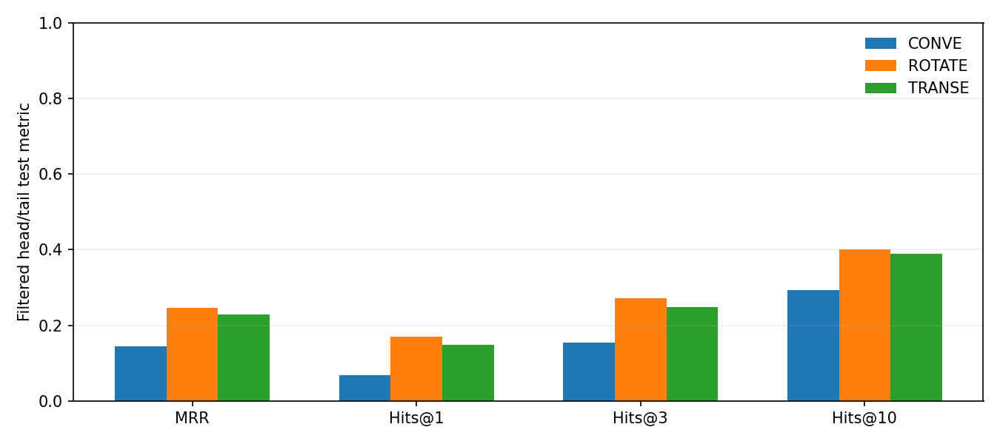
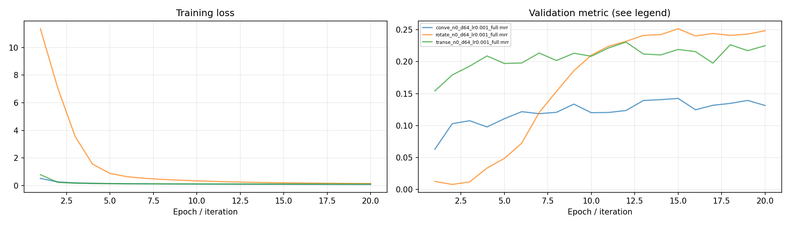
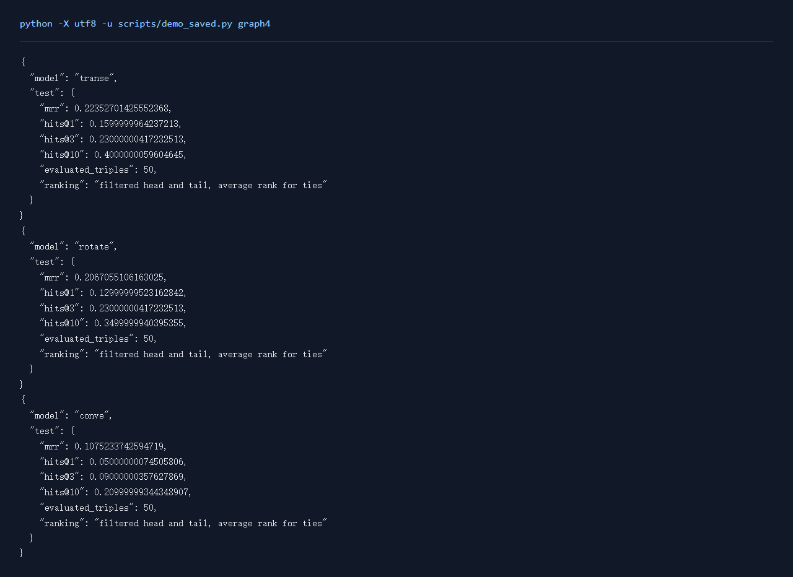

# Graph任务4：知识图谱补全

## 一、实验环境与条件

Windows 11，Python 3.11，RTX 3050 Ti Laptop 4GB。PyTorch 2.6.0+cu124；图任务使用PyG 2.6.1。NumPy分类运行在CPU，神经网络训练使用CUDA。种子默认为42。完整版本与下载来源见[环境说明](../../学习报告/实验环境.md)。

## 二、实验方法与过程

参考Maxioo/kge_framework的三元组输入、负采样与filtered排名流程，用PyTorch实现TransE、RotatE与ConvE的统一评分接口。参考代码保存在根目录kge_framework/code，本地训练入口在本任务code目录。在FB15k-237官方划分上使用全部训练三元组，训练20轮，固定200条验证样本选优，测试遍历完整测试集。每条测试三元组分别替换头实体和尾实体，在全部实体候选中做filtered排序，计算MRR、Hits@1/3/10。

### 实现与知识点

TransE希望 `h+r≈t`，以负距离评分；RotatE把实体放在复数空间，用单位模关系向量旋转头实体；ConvE把头实体与关系重排成二维网格，经卷积、投影，与尾实体向量相乘评分。负采样随机替换头或尾，剔除训练已知真三元组。

评估为每条三元组分别替换头和尾，在全部实体中排序。filtered评估先排除其余已知真三元组，再保留当前正确实体，避免另一个真实答案被算成错误。MRR是倒数排名的平均值，Hits@k是正确实体位于前k名的比例。同分候选采用平均排名。

### 复现命令

在项目根目录运行：

```powershell
.\.venv\Scripts\python.exe graph_beginner/task4/code/train.py --model rotate --epochs 20 --limit 0 --eval-limit 200 --test-limit 0 --batch 1024 --negatives 8 --tag _full
.\.venv\Scripts\python.exe scripts/verify_kge_ranking.py
```

全部新增对照可通过 `python scripts/quality_runs.py`、`python scripts/quality_extra_runs.py` 与 `python scripts/quality_followup_runs.py` 顺序复现，结果和权重完整的成功命令会按日志跳过。

## 三、实验结果及分析

| 实验配置 | 训练规模 | 轮数 | 验证指标 | 测试指标 | 运行时间 / s |
|---|---:|---:|---|---|---:|
| [conve_n0_d64_lr0.001_full](results/conve_n0_d64_lr0.001_full.json) | 272115 | 20 | mrr=0.1424 | mrr=0.1439; hits@10=0.2937 | 165.6 |
| [rotate_n0_d64_lr0.001_full](results/rotate_n0_d64_lr0.001_full.json) | 272115 | 20 | mrr=0.2516 | mrr=0.2473; hits@10=0.4007 | 143.8 |
| [transe_n0_d64_lr0.001_full](results/transe_n0_d64_lr0.001_full.json) | 272115 | 20 | mrr=0.2307 | mrr=0.2281; hits@10=0.3883 | 120.0 |

当前数据按验证集选择的配置为 `rotate_n0_d64_lr0.001_full`，mrr=0.2516，测试结果为 mrr=0.2473; hits@10=0.4007。

| 模型 | MRR | Hits@1 | Hits@3 | Hits@10 | 测试三元组 |
|---|---:|---:|---:|---:|---:|
| CONVE | 0.1439 | 0.0692 | 0.1545 | 0.2937 | 20466 |
| ROTATE | 0.2473 | 0.1697 | 0.2727 | 0.4007 | 20466 |
| TRANSE | 0.2281 | 0.1486 | 0.2482 | 0.3883 | 20466 |

每条测试三元组分别预测头与尾，因此完整评价包含40,932次排名。filtered处理从候选中排除其他已知正确实体，目标实体保留。MRR强调目标靠前的程度，Hits@10记录目标进入前十的比例。三个模型在相同数据划分上比较，验证抽样和维度在结果配置中保留。

ConvE将正负三元组合并前向后，完整测试MRR由0.0647变为0.1439，Hits@10由0.1391变为0.2937。两次均使用相同种子、20轮及完整测试划分，修正了BatchNorm按正负样本分别统计的问题。

[原分组前向结果](../../运行记录/诊断/conve_separate_bn.json)

### 测试指标对照



### 训练曲线



### 实际运行截图

以下为加载保存参数并运行留出样例的本地页面原始截屏；完整测试指标见上表。



[原始输出](../../学习报告/运行截图/graph4.txt) · [执行记录](../../学习报告/运行截图/graph4.json)

## 四、遇到的问题及处理情况

直接逐候选调用ConvE较慢，改为按关系缓存头实体查询并以矩阵运算评分；TransE和RotatE也合并候选计算。优化后用小图直接评分逐一核对MRR，三种模型均通过。ConvE早期分别前向正负样本，BatchNorm统计随两组输入改变；改为把正负三元组合并后一次前向，再分别计算损失。验证固定抽样，测试使用完整划分。
