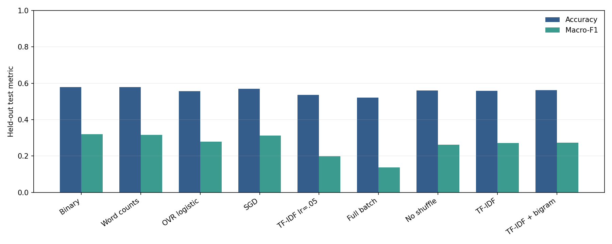
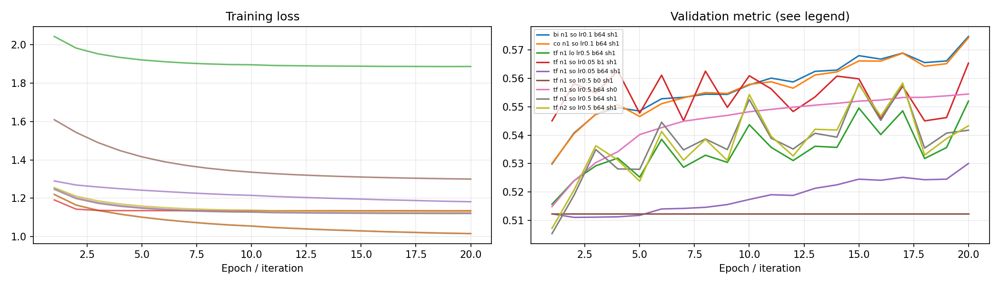
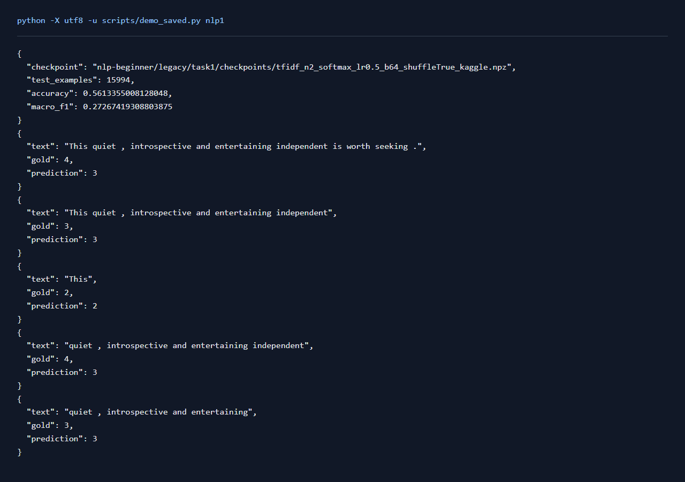

# NLP任务1：NumPy文本分类

## 一、实验环境与条件

Windows 11，Python 3.11，RTX 3050 Ti Laptop 4GB。PyTorch 2.6.0+cu124；图任务使用PyG 2.6.1。NumPy分类运行在CPU，神经网络训练使用CUDA。种子默认为42。完整版本与下载来源见[环境说明](../../../学习报告/实验环境.md)。

## 二、实验方法与过程

读取Kaggle电影评论的156,060条短语，按SentenceId分组，以固定种子42划分训练、验证、测试，数量分别为124,481、15,585、15,994。词表及IDF只在训练集拟合。用NumPy手写softmax和one-vs-rest logistic的损失、梯度及更新，比较count、binary、TF-IDF、unigram/bigram、学习率、批量大小和shuffle，共9组。

### 实现与知识点

词袋只统计单词出现次数，不记录顺序。binary 只保留是否出现；TF-IDF 降低常见词的权重；二元 n-gram 可表示局部搭配。词表与 IDF 只在训练集拟合，验证和测试只能 transform。

Softmax 的概率是 `exp(z_k)/sum(exp(z))`，交叉熵为 `-log p_y`。先减最大 logit 避免指数溢出。梯度是 `X.T @ (p-one_hot(y))/B`。本实现的 logistic 是五个 one-vs-rest 二分类器，BCE 对类别求和，再取样本均值。参数更新由 NumPy 手写，sklearn 只负责特征和评估。

`batch=0` 表示全批次，`batch=1` 表示逐样本 SGD，`batch=64` 表示 mini-batch。同为20轮时，更新次数并不相同。shuffle 每轮重排样本；不shuffle可能使更新带上数据排序的偏差。学习率过大可能振荡，过小可能还未学够，需看验证曲线。

上述梯度对应数据损失部分。代码同时采用固定λ=1e-4的L2正则，损失增加`λ/2 * sum(W²)`，权重梯度增加`λW`，偏置保留原梯度。它约束权重大小，各组使用相同系数。

### 复现命令

在项目根目录运行：

```powershell
.\.venv\Scripts\python.exe nlp-beginner/legacy/train_numpy.py --features tfidf --loss softmax --epochs 20 --data-name sentiment_kaggle
.\.venv\Scripts\python.exe scripts/run_matrix.py nlp
```

全部新增对照可通过 `python scripts/quality_runs.py`、`python scripts/quality_extra_runs.py` 与 `python scripts/quality_followup_runs.py` 顺序复现，结果和权重完整的成功命令会按日志跳过。

## 三、实验结果及分析

| 实验配置 | 训练规模 | 轮数 | 验证指标 | 测试指标 | 运行时间 / s |
|---|---:|---:|---|---|---:|
| [binary_n1_softmax_lr0.1_b64_shuffleTrue_kaggle](results/binary_n1_softmax_lr0.1_b64_shuffleTrue_kaggle.json) | 124481 | 20 | accuracy=0.5747 | accuracy=0.5781; macro_f1=0.3189 | 19.6 |
| [count_n1_softmax_lr0.1_b64_shuffleTrue_kaggle](results/count_n1_softmax_lr0.1_b64_shuffleTrue_kaggle.json) | 124481 | 20 | accuracy=0.5742 | accuracy=0.5787; macro_f1=0.3166 | 19.2 |
| [tfidf_n1_logistic_lr0.5_b64_shuffleTrue_kaggle](results/tfidf_n1_logistic_lr0.5_b64_shuffleTrue_kaggle.json) | 124481 | 20 | accuracy=0.5519 | accuracy=0.5560; macro_f1=0.2788 | 22.6 |
| [tfidf_n1_softmax_lr0.05_b1_shuffleTrue_kaggle](results/tfidf_n1_softmax_lr0.05_b1_shuffleTrue_kaggle.json) | 124481 | 20 | accuracy=0.5653 | accuracy=0.5698; macro_f1=0.3128 | 1182.3 |
| [tfidf_n1_softmax_lr0.05_b64_shuffleTrue_kaggle](results/tfidf_n1_softmax_lr0.05_b64_shuffleTrue_kaggle.json) | 124481 | 20 | accuracy=0.5301 | accuracy=0.5361; macro_f1=0.1992 | 20.3 |
| [tfidf_n1_softmax_lr0.5_b0_shuffleTrue_kaggle](results/tfidf_n1_softmax_lr0.5_b0_shuffleTrue_kaggle.json) | 124481 | 20 | accuracy=0.5124 | accuracy=0.5206; macro_f1=0.1370 | 1.2 |
| [tfidf_n1_softmax_lr0.5_b64_shuffleFalse_kaggle](results/tfidf_n1_softmax_lr0.5_b64_shuffleFalse_kaggle.json) | 124481 | 20 | accuracy=0.5544 | accuracy=0.5608; macro_f1=0.2617 | 15.1 |
| [tfidf_n1_softmax_lr0.5_b64_shuffleTrue_kaggle](results/tfidf_n1_softmax_lr0.5_b64_shuffleTrue_kaggle.json) | 124481 | 20 | accuracy=0.5581 | accuracy=0.5585; macro_f1=0.2708 | 22.3 |
| [tfidf_n2_softmax_lr0.5_b64_shuffleTrue_kaggle](results/tfidf_n2_softmax_lr0.5_b64_shuffleTrue_kaggle.json) | 124481 | 20 | accuracy=0.5583 | accuracy=0.5613; macro_f1=0.2727 | 23.1 |

当前数据按验证集选择的配置为 `binary_n1_softmax_lr0.1_b64_shuffleTrue_kaggle`，accuracy=0.5747，测试结果为 accuracy=0.5781; macro_f1=0.3189。
Kaggle测试集中五类数量为 `{0: 718, 1: 2893, 2: 8327, 3: 3177, 4: 879}`，只预测最多类别的准确率为 0.5206。短语中有较多中性词组，accuracy和macro-F1需要一起观察；macro-F1能反映少数类别的识别情况。
按124,481条训练数据和20轮计算，full-batch共更新20次，batch=64共更新38,920次，SGD共更新2,489,620次。每轮覆盖相同数据，参数更新的频率和训练时间差异很大。SGD和mini-batch可在学习率0.05的两组间对照；full-batch和mini-batch可在0.5的两组间对照。

### 测试指标对照



### 训练曲线



### 实际运行截图

以下为加载保存参数并运行留出样例的本地页面原始截屏；完整测试指标见上表。



[原始输出](../../../学习报告/运行截图/nlp1.txt) · [执行记录](../../../学习报告/运行截图/nlp1.json)

## 四、遇到的问题及处理情况

最初的句子级SST-5与原题的短语数据规模不同，补取Kaggle原始train.tsv并记录SHA-256。短语共享SentenceId，采用分组划分处理潜在的数据泄漏。NumPy词表编号序列化时转为Python整数。
