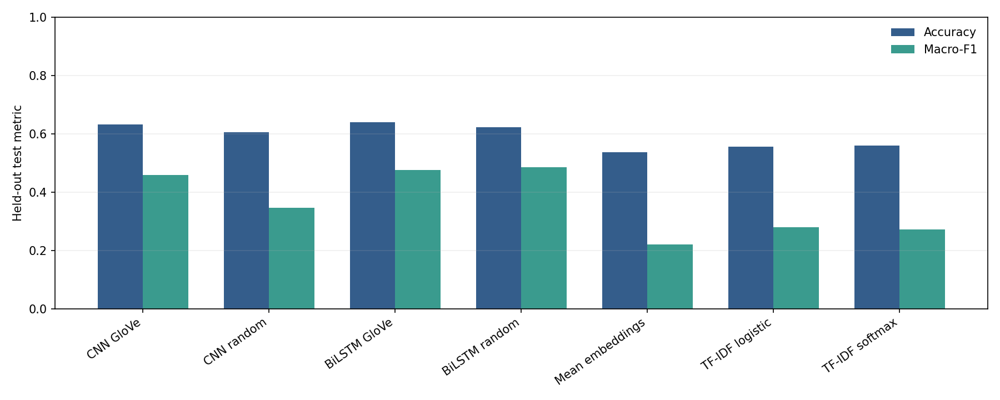
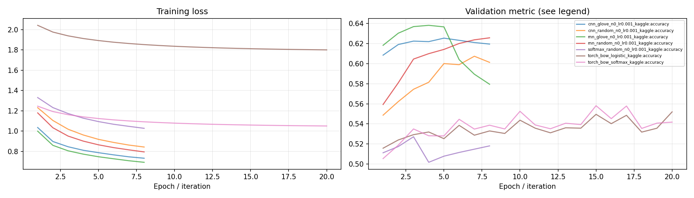
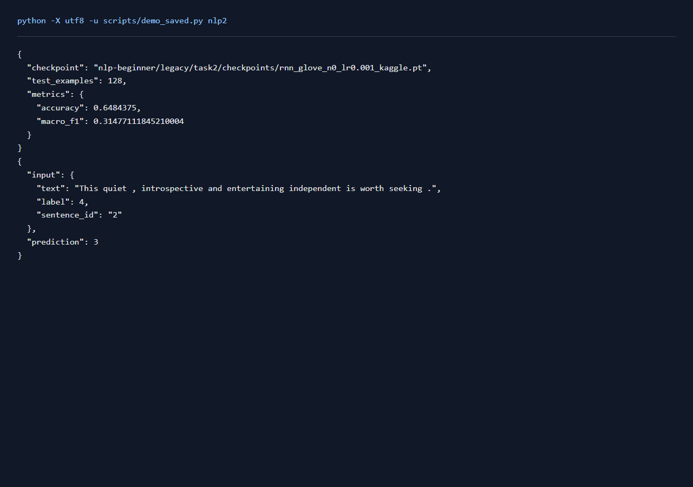

# NLP任务2：PyTorch分类与词嵌入

## 一、实验环境与条件

Windows 11，Python 3.11，RTX 3050 Ti Laptop 4GB。PyTorch 2.6.0+cu124；图任务使用PyG 2.6.1。NumPy分类运行在CPU，神经网络训练使用CUDA。种子默认为42。完整版本与下载来源见[环境说明](../../../学习报告/实验环境.md)。

## 二、实验方法与过程

沿用任务一的数据划分与TF-IDF，用PyTorch复写两种线性分类器，并核对一批真实样本的损失和梯度。随后训练平均词向量、CNN与双向LSTM分类器，对CNN和LSTM分别使用随机词向量与50维GloVe初始化，共7组。每轮训练后在验证集选优，最后在测试集评价。

### 实现与知识点

`train_torch_bow.py` 用相同 TF-IDF、零初始化和 SGD 复写任务1，并检查两种损失及参数梯度与 NumPy 一致。另一个名为 softmax 的模型是词向量均值加线性分类器，它与 TF-IDF 基线的表示不同，应分开理解。

CNN 用3/5/7宽度卷积提取局部特征，ReLU后进行最大池化；padding位置不能参与池化。RNN为双向LSTM，按真实长度打包，再拼接均值和最大池化特征。Embedding 把离散词编号映射为可训练向量。GloVe初始化有语料知识，未命中的词仍随机初始化，报告里保留覆盖率，训练时不冻结词向量。

Dropout 在训练时随机置零部分特征，推理必须 `model.eval()`。`zero_grad → forward → backward → step` 是基本训练顺序；验证用 `no_grad`。

### 复现命令

在项目根目录运行：

```powershell
.\.venv\Scripts\python.exe nlp-beginner/legacy/train_torch_bow.py --loss softmax --data-name sentiment_kaggle
.\.venv\Scripts\python.exe nlp-beginner/legacy/train_torch_bow.py --loss logistic --data-name sentiment_kaggle
.\.venv\Scripts\python.exe nlp-beginner/legacy/train_torch.py classification --model cnn --epochs 8 --data-name sentiment_kaggle
.\.venv\Scripts\python.exe nlp-beginner/legacy/train_torch.py classification --model cnn --epochs 8 --glove nlp-beginner/legacy/data/raw/glove/glove.6B.50d.txt --data-name sentiment_kaggle
```

全部新增对照可通过 `python scripts/quality_runs.py`、`python scripts/quality_extra_runs.py` 与 `python scripts/quality_followup_runs.py` 顺序复现，结果和权重完整的成功命令会按日志跳过。

## 三、实验结果及分析

| 实验配置 | 训练规模 | 轮数 | 验证指标 | 测试指标 | 运行时间 / s |
|---|---:|---:|---|---|---:|
| [cnn_glove_n0_lr0.001_kaggle](results/cnn_glove_n0_lr0.001_kaggle.json) | 124481 | 8 | score=0.6254 | accuracy=0.6321; macro_f1=0.4584 | 90.1 |
| [cnn_random_n0_lr0.001_kaggle](results/cnn_random_n0_lr0.001_kaggle.json) | 124481 | 8 | score=0.6074 | accuracy=0.6049; macro_f1=0.3455 | 99.6 |
| [rnn_glove_n0_lr0.001_kaggle](results/rnn_glove_n0_lr0.001_kaggle.json) | 124481 | 8 | score=0.6382 | accuracy=0.6400; macro_f1=0.4753 | 239.2 |
| [rnn_random_n0_lr0.001_kaggle](results/rnn_random_n0_lr0.001_kaggle.json) | 124481 | 8 | score=0.6257 | accuracy=0.6230; macro_f1=0.4852 | 254.5 |
| [softmax_random_n0_lr0.001_kaggle](results/softmax_random_n0_lr0.001_kaggle.json) | 124481 | 8 | score=0.5272 | accuracy=0.5368; macro_f1=0.2198 | 63.7 |
| [torch_bow_logistic_kaggle](results/torch_bow_logistic_kaggle.json) | 124481 | 20 | accuracy=0.5519 | accuracy=0.5560; macro_f1=0.2788 | 164.6 |
| [torch_bow_softmax_kaggle](results/torch_bow_softmax_kaggle.json) | 124481 | 20 | accuracy=0.5581 | accuracy=0.5585; macro_f1=0.2708 | 167.1 |

当前数据按验证集选择的配置为 `rnn_glove_n0_lr0.001_kaggle`，score=0.6382，测试结果为 accuracy=0.6400; macro_f1=0.4753。
Kaggle测试集中五类数量为 `{0: 718, 1: 2893, 2: 8327, 3: 3177, 4: 879}`，只预测最多类别的准确率为 0.5206。短语中有较多中性词组，accuracy和macro-F1需要一起观察；macro-F1能反映少数类别的识别情况。
CNN随机初始化测试accuracy=0.6049、macro-F1=0.3455；GloVe初始化为0.6321、0.4584，accuracy变化+0.0272。两组采用相同数据与训练轮数，词向量在训练中继续更新。
RNN随机初始化测试accuracy=0.6230、macro-F1=0.4852；GloVe初始化为0.6400、0.4753，accuracy变化+0.0169。两组采用相同数据与训练轮数，词向量在训练中继续更新。
`cnn_glove_n0_lr0.001_kaggle` 的 GloVe 词表覆盖率为 98.00%，其余词保留随机初始化。
`rnn_glove_n0_lr0.001_kaggle` 的 GloVe 词表覆盖率为 98.00%，其余词保留随机初始化。

### 测试指标对照



### 训练曲线



[各类别precision、recall、F1及错误样例](../../../运行记录/诊断/task2_classes.json)

各类别指标对应检查点 `rnn_glove_n0_lr0.001_kaggle`，在完整测试集上重新计算。

| 类别 | Precision | Recall | F1 | 测试样本 |
|---|---:|---:|---:|---:|
| 负面 | 0.6803 | 0.1393 | 0.2312 | 718 |
| 较负面 | 0.4899 | 0.5009 | 0.4953 | 2893 |
| 中性 | 0.7123 | 0.8298 | 0.7666 | 8327 |
| 较正面 | 0.5459 | 0.4885 | 0.5156 | 3177 |
| 正面 | 0.6522 | 0.2560 | 0.3676 | 879 |

### 实际运行截图

以下为加载保存参数并运行留出样例的本地页面原始截屏；完整测试指标见上表。



[原始输出](../../../学习报告/运行截图/nlp2.txt) · [执行记录](../../../学习报告/运行截图/nlp2.json)

## 四、遇到的问题及处理情况

CNN池化需要屏蔽padding；LSTM使用真实长度打包。线性模型保留相同特征、零初始化和SGD，便于检验NumPy与PyTorch的对应关系。GloVe下载采用分块续传，并核对ZIP条目的大小和CRC。读取GloVe时会生成未命中词的随机向量，因此在构造分类模型前重新固定种子，使随机/GloVe两组的分类头与训练顺序保持一致。
