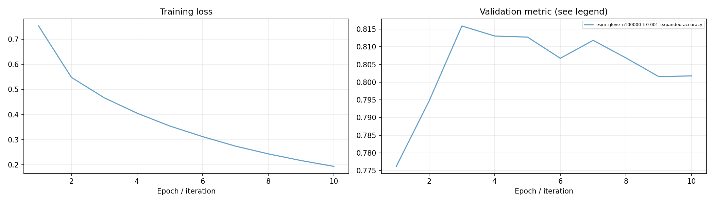
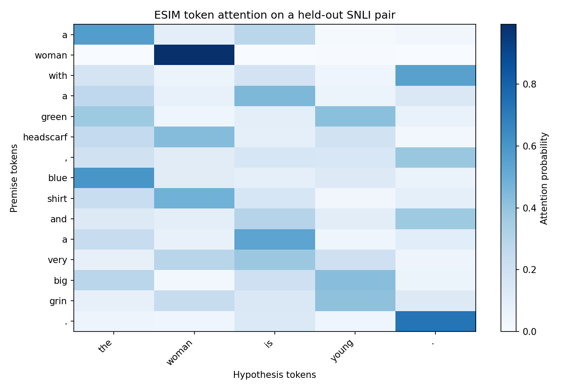
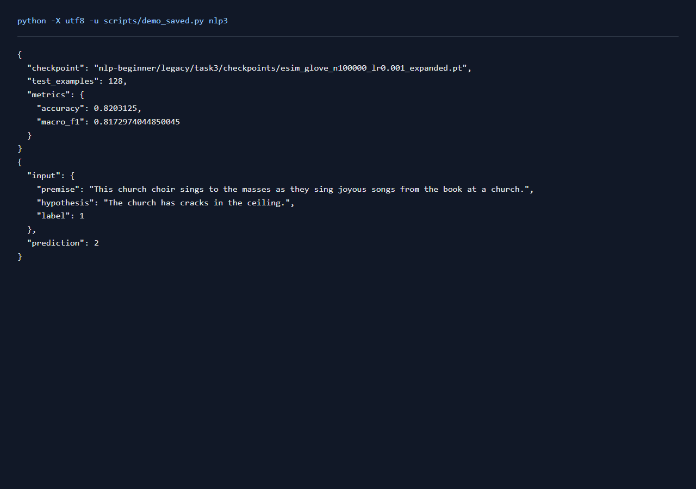

# NLP任务3：ESIM自然语言推断

## 一、实验环境与条件

Windows 11，Python 3.11，RTX 3050 Ti Laptop 4GB。PyTorch 2.6.0+cu124；图任务使用PyG 2.6.1。NumPy分类运行在CPU，神经网络训练使用CUDA。种子默认为42。完整版本与下载来源见[环境说明](../../../学习报告/实验环境.md)。

## 二、实验方法与过程

使用SNLI官方划分，过滤无共识标签。新增实验固定采样100,000条训练数据，验证和测试使用完整有效划分，训练10轮。模型采用GloVe初始化、共享双向LSTM、双向词级注意力与局部推断组合，分类目标为蕴含、矛盾和中立。

### 实现与知识点

先用共享BiLSTM编码 premise 与 hypothesis。对任意两个词的隐状态计算点积 `e_ij = a_i dot b_j`；在对方有效token上softmax，得到两向对齐表示。拼接 `x, aligned, x-aligned, x*aligned`，经投影和第二个BiLSTM组合，最后对两句做均值/最大池化，预测蕴含、矛盾或中立。

注意力softmax前要屏蔽padding，否则模型会把概率分给不存在的词。SNLI中label=-1的无共识样本被排除。3分类的均匀随机准确率约1/3，可作最简单的基线。

### 复现命令

在项目根目录运行：

```powershell
.\.venv\Scripts\python.exe nlp-beginner/legacy/train_torch.py matching --model esim --limit 100000 --eval-limit 0 --glove nlp-beginner/legacy/data/raw/glove/glove.6B.50d.txt --epochs 10 --batch 64 --tag _expanded
```

全部新增对照可通过 `python scripts/quality_runs.py`、`python scripts/quality_extra_runs.py` 与 `python scripts/quality_followup_runs.py` 顺序复现，结果和权重完整的成功命令会按日志跳过。

## 三、实验结果及分析

| 实验配置 | 训练规模 | 轮数 | 验证指标 | 测试指标 | 运行时间 / s |
|---|---:|---:|---|---|---:|
| [esim_glove_n100000_lr0.001_expanded](results/esim_glove_n100000_lr0.001_expanded.json) | 100000 | 10 | score=0.8159 | accuracy=0.8127; macro_f1=0.8121 | 803.3 |

当前数据按验证集选择的配置为 `esim_glove_n100000_lr0.001_expanded`，score=0.8159，测试结果为 accuracy=0.8127; macro_f1=0.8121。
`esim_glove_n100000_lr0.001_expanded` 的 GloVe 词表覆盖率为 91.09%，其余词保留随机初始化。

### 训练曲线



[各类别precision、recall、F1及错误样例](../../../运行记录/诊断/task3_classes.json)

各类别指标对应检查点 `esim_glove_n100000_lr0.001_expanded`，在完整测试集上重新计算。

| 类别 | Precision | Recall | F1 | 测试样本 |
|---|---:|---:|---:|---:|
| 蕴含 | 0.8207 | 0.8631 | 0.8414 | 3368 |
| 中立 | 0.7667 | 0.7679 | 0.7673 | 3219 |
| 矛盾 | 0.8519 | 0.8048 | 0.8276 | 3237 |

中立类F1低于蕴含和矛盾。模型需要判断前提是否足以支持结论，词汇相关性容易干扰这种判断。例如前提只提到教堂唱诗班唱歌，假设“教堂天花板有裂缝”应为中立，当前模型预测为矛盾。

验证集最佳轮次为第3轮，accuracy=0.8159；末轮为0.8018。训练损失从0.7523降至0.1936。参数保存采用验证选优，因此后续训练的波动不会覆盖较好的模型。

### 词级注意力



每一行对应premise中的一个词，颜色表示分配给hypothesis各词的注意力概率，行概率和为1。矩阵由留出样例和保存的模型参数计算。

### 实际运行截图

以下为加载保存参数并运行留出样例的本地页面原始截屏；完整测试指标见上表。



[原始输出](../../../学习报告/运行截图/nlp3.txt) · [执行记录](../../../学习报告/运行截图/nlp3.json)

## 四、遇到的问题及处理情况

SNLI镜像下载出现连接中断，使用带Content-Range核对的续传并校验哈希。扩大训练子集后保留早期2万条实验作为过程记录，正式表格使用新增实验。
