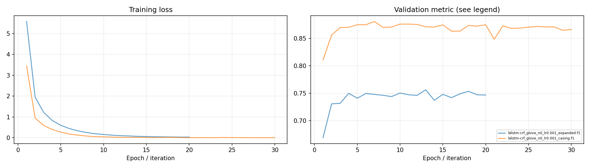
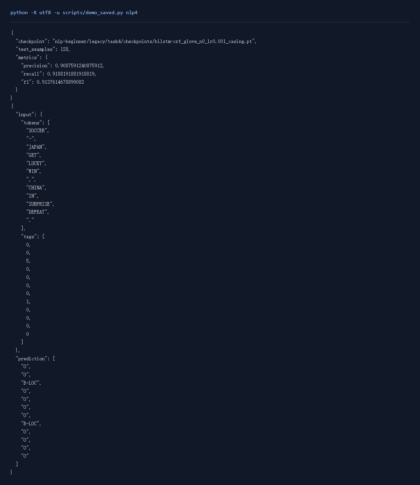

# NLP任务4：BiLSTM-CRF实体识别

## 一、实验环境与条件

Windows 11，Python 3.11，RTX 3050 Ti Laptop 4GB。PyTorch 2.6.0+cu124；图任务使用PyG 2.6.1。NumPy分类运行在CPU，神经网络训练使用CUDA。种子默认为42。完整版本与下载来源见[环境说明](../../../学习报告/实验环境.md)。

## 二、实验方法与过程

使用CoNLL-2003官方训练、验证与测试数据。双向LSTM产生BIO标签的发射分数，自写CRF计算路径似然，Viterbi求最优标签序列。基础实验使用GloVe，隐层64维，训练20轮；扩展实验拼接8维大小写特征，将隐层增至128维，训练30轮。长度上限512，数据中最长句为124个词。评价采用实体边界和类型都正确的实体级precision、recall、F1。

### 实现与知识点

BiLSTM给出每个位置每种BIO标签的发射分数，CRF再加相邻标签的转移分数及起止分数。一条标签路径的分数为这些项之和。负对数似然是 `logsumexp(所有路径分数)-正确路径分数`。前向动态规划用logsumexp计算配分函数，Viterbi把logsumexp换为max并记录回溯指针。

实体级precision/recall/F1要求实体边界和类型都正确，token accuracy反映逐词标签的正确率，两者的评价含义不同。长短句共批训练时，mask必须同时进入路径评分、配分函数和解码。已用短序列穷举所有路径核对动态规划和Viterbi。当前是普通可学习转移CRF，没有额外强制BIO转移约束。

### 复现命令

在项目根目录运行：

```powershell
.\.venv\Scripts\python.exe nlp-beginner/legacy/train_torch.py ner --model bilstm-crf --glove nlp-beginner/legacy/data/raw/glove/glove.6B.50d.txt --epochs 20 --max-length 512 --batch 32 --tag _expanded
.\.venv\Scripts\python.exe nlp-beginner/legacy/train_torch.py ner --model bilstm-crf --glove nlp-beginner/legacy/data/raw/glove/glove.6B.50d.txt --epochs 30 --hidden 128 --max-length 512 --batch 32 --use-case --tag _casing
.\.venv\Scripts\python.exe scripts/verify_algorithms.py
```

全部新增对照可通过 `python scripts/quality_runs.py`、`python scripts/quality_extra_runs.py` 与 `python scripts/quality_followup_runs.py` 顺序复现，结果和权重完整的成功命令会按日志跳过。

## 三、实验结果及分析

| 实验配置 | 训练规模 | 轮数 | 验证指标 | 测试指标 | 运行时间 / s |
|---|---:|---:|---|---|---:|
| [bilstm-crf_glove_n0_lr0.001_expanded](results/bilstm-crf_glove_n0_lr0.001_expanded.json) | 14041 | 20 | score=0.7563 | f1=0.6784 | 692.7 |
| [bilstm-crf_glove_n0_lr0.001_casing](results/bilstm-crf_glove_n0_lr0.001_casing.json) | 14041 | 30 | score=0.8805 | f1=0.8090 | 1001.6 |

当前数据按验证集选择的配置为 `bilstm-crf_glove_n0_lr0.001_casing`，score=0.8805，测试结果为 f1=0.8090。
`bilstm-crf_glove_n0_lr0.001_expanded` 的 GloVe 词表覆盖率为 87.65%，其余词保留随机初始化。
`bilstm-crf_glove_n0_lr0.001_casing` 的 GloVe 词表覆盖率为 87.65%，其余词保留随机初始化。

### 训练曲线



验证集最佳轮次为第7轮，f1=0.8805；末轮为0.8658。训练损失从3.4486降至0.0037。参数保存采用验证选优，因此后续训练的波动不会覆盖较好的模型。

| 实体类型 | Precision | Recall | F1 | 测试实体 |
|---|---:|---:|---:|---:|
| PER | 0.6836 | 0.9419 | 0.7922 | 1617 |
| ORG | 0.8522 | 0.7429 | 0.7938 | 1661 |
| LOC | 0.9259 | 0.8309 | 0.8758 | 1668 |
| MISC | 0.7206 | 0.7607 | 0.7401 | 702 |

[实体类别指标与逐词错误样例](../../../运行记录/诊断/task4_entities.json)

上表对应按验证F1选出的检查点 `bilstm-crf_glove_n0_lr0.001_casing`。基础模型的小写词编号与GloVe会丢失原词形信息，扩展模型拼接可学习的大小写类别表示。两组同时改变了隐层宽度和训练轮数，差值反映这套扩展配置的整体效果。逐词错误样例用于继续检查未见专名、实体边界和类型混淆。

[完整CoNLL测试标签核对](../../../运行记录/诊断/conll_reference_check.json)

### 实际运行截图

以下为加载保存参数并运行留出样例的本地页面原始截屏；完整测试指标见上表。



[原始输出](../../../学习报告/运行截图/nlp4.txt) · [执行记录](../../../学习报告/运行截图/nlp4.json)

## 四、遇到的问题及处理情况

早期长度上限100会截断少量句子的尾部，新增实验提高到512。CRF前向算法和Viterbi用短序列穷举校验，mask同时作用于路径分数、配分函数和解码。另把完整测试集与公开CoNLL副本转换成相同BIO格式后逐句核对，3,453句的词序列与标签均一致。大小写特征保留原词形，词向量仍使用小写词编号。
