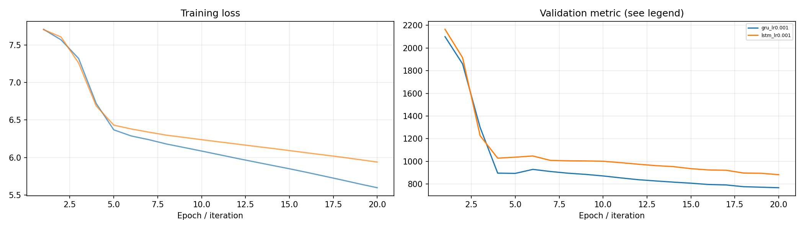
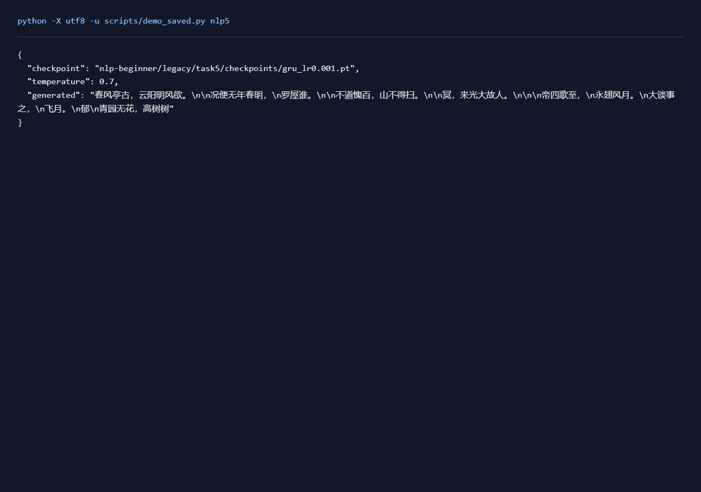

# NLP任务5：唐诗字符语言模型

## 一、实验环境与条件

Windows 11，Python 3.11，RTX 3050 Ti Laptop 4GB。PyTorch 2.6.0+cu124；图任务使用PyG 2.6.1。NumPy分类运行在CPU，神经网络训练使用CUDA。种子默认为42。完整版本与下载来源见[环境说明](../../../学习报告/实验环境.md)。

## 二、实验方法与过程

将唐诗文本先按连续区段划为80%、10%、10%，分别建立字符窗口，输入和目标错开一个字符。LSTM与GRU各训练20轮，按验证困惑度选择参数，计算测试困惑度，并在温度0.7和1.0下生成80个字符。

### 实现与知识点

字符语言模型预测下一个字符，训练输入与标签错开一个位置。LSTM有输入、遗忘、输出门和独立cell state；GRU用更新与重置门合并部分状态。交叉熵按有效字符平均，困惑度为 `exp(平均负对数似然)`，越低表示模型对真实下一个字符越有把握。

先按连续文本80/10/10划分，再分别建立窗口，使各划分保留不同的原始文本区段。生成用前文状态循环采样，温度0.7更集中、1.0更分散。词表只由训练区段建立，测试未见字符映射到unk并记数量。

### 复现命令

在项目根目录运行：

```powershell
.\.venv\Scripts\python.exe nlp-beginner/legacy/train_torch.py lm --model lstm --epochs 20
.\.venv\Scripts\python.exe nlp-beginner/legacy/train_torch.py lm --model gru --epochs 20
```

全部新增对照可通过 `python scripts/quality_runs.py`、`python scripts/quality_extra_runs.py` 与 `python scripts/quality_followup_runs.py` 顺序复现，结果和权重完整的成功命令会按日志跳过。

## 三、实验结果及分析

| 实验配置 | 训练规模 | 轮数 | 验证指标 | 测试指标 | 运行时间 / s |
|---|---:|---:|---|---|---:|
| [gru_lr0.001](results/gru_lr0.001.json) | 13317字符 | 20 | — | loss=6.4633; perplexity=641.1928 | 9.6 |
| [lstm_lr0.001](results/lstm_lr0.001.json) | 13317字符 | 20 | — | loss=6.5613; perplexity=707.1883 | 6.6 |

`gru_lr0.001` 的生成样例：

```json
{
  "0.7": "春风菲里原。\n\n须深路，日李。\n故驴，仙，落即客子香。\n\n子人子失，寒薄杯秣，前莫愿心。\n\n\n巴王亦夕，飘夜马龙无所，\n满食江与，\n寒台雄，碧芽皇合。\n\n卧兹长，一",
  "1.0": "春风命时身与教枝冷老。\n槔悄臣人云，吴名骢东。 楚竹愧抚沙云，不悲滋虎真。青口屠复出间。右如未为知，鲜速势兴不。事日郢莫口省苔。高叶予莫有参汝，弟之陂深林，人面然壑"
}
```
`lstm_lr0.001` 的生成样例：

```json
{
  "0.7": "春风稚枻\n千。\n\n梅男此禁。\n\n离。\n三朽魂，惟吟。\n\n\n\n高子思花，，遗，腾龙客螭。\n\n今来无弦，扬里知不。\n根生未，草间。\n\n\n\n\n\n极水顾人，\n十春未影，\n留",
  "1.0": "春风男枿荡人，慎日唱搜仁崔水晚平，台食。\n达待看如珠赫。列屡刈草穷，人白诗尺更，来秦。\n将毒拥争昔新湿。尘撑绝，安宋鼻照，终宾林族走。\n\n晨兰用随，阳群鱼王合。尺争"
}
```

### 训练曲线



### 实际运行截图

以下为加载保存参数并运行留出样例的本地页面原始截屏；完整测试指标见上表。



[原始输出](../../../学习报告/运行截图/nlp5.txt) · [执行记录](../../../学习报告/运行截图/nlp5.json)

## 四、遇到的问题及处理情况

先划分连续文本再切窗口，使留出区段保持独立。字符词表由训练区段建立，未见字符映射到unk，数量记录在结果中。生成时保留循环隐状态，避免每个字符都重新从空状态开始。
