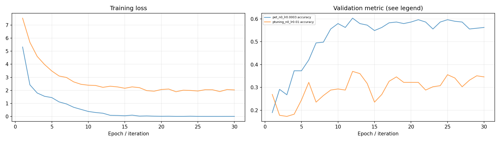

# Prompt实验报告

## 一、实验环境与条件

依赖与设备见[实验环境](实验环境.md)。下表中的训练数量、轮数和配置来自实际运行记录，默认种子42。

## 二、实验方法与过程

在少量评论上比较PET与p-tuning。PET使用“这是一条[MASK][MASK]评论：…”模板，将类别映射到两个字的标签词。p-tuning在首个token后插入8个可学习连续向量，冻结BERT参数，仅训练prompt。

### 实现与知识点

PET把分类改写为掩码词预测，类别得分由标签词各位置的log概率求和。p-tuning中的prompt是可学习向量，优化时梯度经过冻结模型回传到这些向量。标签词长度保持相同，避免类别因token数量不同而产生不公平得分。

### 复现命令

```powershell
.\.venv\Scripts\python.exe transformers_tasks/local_runs/bert_tasks.py pet --epochs 30
.\.venv\Scripts\python.exe transformers_tasks/local_runs/bert_tasks.py ptuning --epochs 30 --lr .01
```

## 三、实验结果及分析

| 实验配置 | 训练规模 | 轮数 | 验证指标 | 测试指标 | 运行时间 / s |
|---|---:|---:|---|---|---:|
| [pet_n0_lr0.0003](../transformers_tasks/local_runs/results/pet_n0_lr0.0003.json) | 63 | 30 | macro_f1=0.4531 | accuracy=0.6169; macro_f1=0.4561 | 8.6 |
| [ptuning_n0_lr0.01](../transformers_tasks/local_runs/results/ptuning_n0_lr0.01.json) | 63 | 30 | macro_f1=0.2197 | accuracy=0.3684; macro_f1=0.2389 | 6.9 |


当前数据按验证集选择的配置为 `pet_n0_lr0.0003`，macro_f1=0.4531，测试结果为 accuracy=0.6169; macro_f1=0.4561。

### 训练曲线



PET更新掩码语言模型，p-tuning仅更新8个连续prompt向量。当前少样本划分下，两者的可训练容量和标签覆盖差异会影响验证曲线。

### 实际运行截图


[原始输出](运行截图/plm-bert.txt) · [执行记录](运行截图/plm-bert.json)

## 四、遇到的问题及处理情况

原训练样例仅覆盖部分类别，dev出现“电器”。完整schema保留该类别，结果按真实留出标签评价。离散模板和连续prompt共用模型与划分，记录各自可训练参数。
