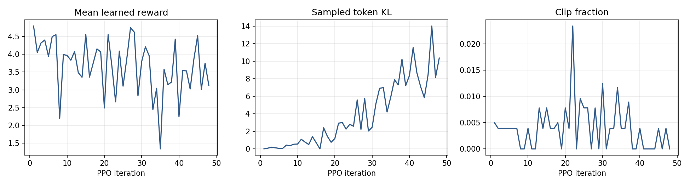
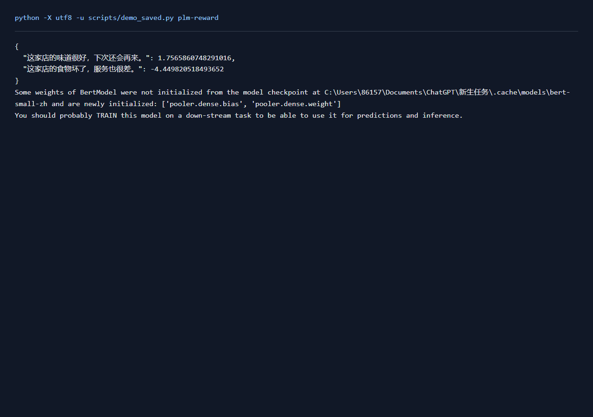
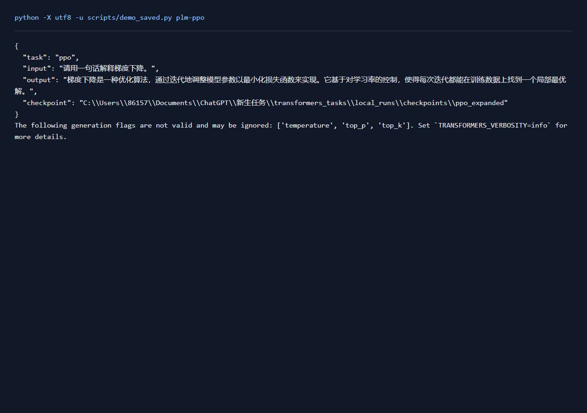

# RLHF实验报告

## 一、实验环境与条件

依赖与设备见[实验环境](实验环境.md)。下表中的训练数量、轮数和配置来自实际运行记录，默认种子42。

## 二、实验方法与过程

把上游排序评论展开为有序偏好对，训练BERT奖励模型。随后在Qwen 0.5B上进行48轮token级PPO更新，保存192条实际生成。每次使用4条训练提示，响应最多32 token，同一轮rollout更新2遍；学习率1e-5、clip=0.2、KL系数0.05。策略使用LoRA，另设价值头；固定参考模型为关闭LoRA后的基座。

### 实现与知识点

奖励损失为-log sigmoid(r(chosen)-r(rejected))。PPO保存旧策略响应token的log概率，计算exp(new_logp-old_logp)比率，以clip约束策略更新。GAE计算优势，价值头拟合回报；奖励中的KL项约束策略偏离参考模型。生成使用温度1、top_p=1、top_k=0，使采样分布与计算log概率一致。

### 复现命令

```powershell
.\.venv\Scripts\python.exe transformers_tasks/local_runs/reward_task.py --limit 1000 --epochs 5
.\.venv\Scripts\python.exe transformers_tasks/local_runs/ppo_task.py --steps 48 --heldout-eval --tag _expanded
.\.venv\Scripts\python.exe transformers_tasks/local_runs/local_tools.py
```

## 三、实验结果及分析

| 实验配置 | 训练规模 | 轮数 | 验证指标 | 测试指标 | 运行时间 / s |
|---|---:|---:|---|---|---:|
| [qwen_ppo_v2_expanded](../transformers_tasks/local_runs/results/qwen_ppo_v2_expanded.json) | 192 | 48 | — | — | 470.7 |
| [reward_n1000](../transformers_tasks/local_runs/results/reward_n1000.json) | 6000 | 5 | preference_accuracy=0.8350 | preference_accuracy=0.8425 | 41.3 |


PPO共48轮，保留192条响应；首轮平均奖励4.7941，末轮3.1243。每轮输入和采样响应会变化，结合完整奖励曲线观察更新过程。

```json
[
  {
    "iteration": 1,
    "prompt": "写一条正面的购物评论，只写评论。商品：苹果。",
    "response": "我非常喜欢这款苹果手机！设计精美，性能强大，启动速度快，并且能高效地处理各种任务和游戏。我认为它是一款值得购买的好手机",
    "reward": 4.9072675704956055,
    "sampled_kl": 0.0,
    "tokens": 32
  }
]
```

固定留出提示上的16条生成：更新前平均奖励3.8594（标准差0.7707），更新后3.3643（标准差1.5263），平均变化-0.4951。这组评价使用训练外的商品和固定采样种子，得分来自同一个冻结的奖励模型。奖励模型学习了评论排序偏好，实际回答还可从商品相关性、语句通顺度和重复片段三个方面分析，更新前后的全文均保存在实验JSON中。



**reward_n1000实际输出**

```json
[
  {
    "text": "买过很多箱这个苹果了，一如既往的好，汁多味甜。",
    "score": 3.7856624126434326
  }
]
```

### 实际运行截图



[原始输出](运行截图/plm-reward.txt) · [执行记录](运行截图/plm-reward.json)

### 实际运行截图



[原始输出](运行截图/plm-ppo.txt) · [执行记录](运行截图/plm-ppo.json)

## 四、遇到的问题及处理情况

上游RLHF以GPT2进行PPO，本机使用Qwen 0.5B与LoRA连接同一个训练完成的奖励模型，保留token级策略更新、参考模型和价值头流程。奖励数据与训练文本分开管理，留出偏好对用于准确率评价。PPO的采样、clip与GAE通过数值检查。人工评价页面保留实际生成内容，评分由阅读者填写，记录在human_ratings.jsonl。
