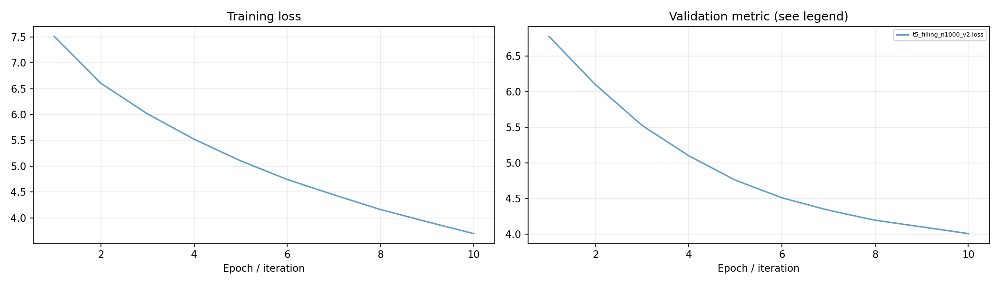
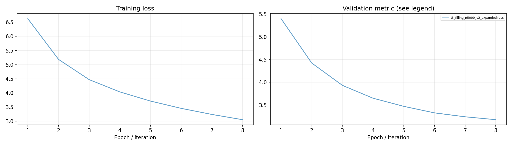
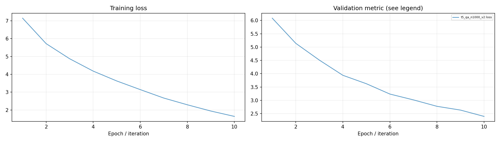
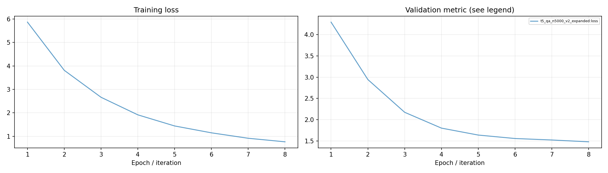
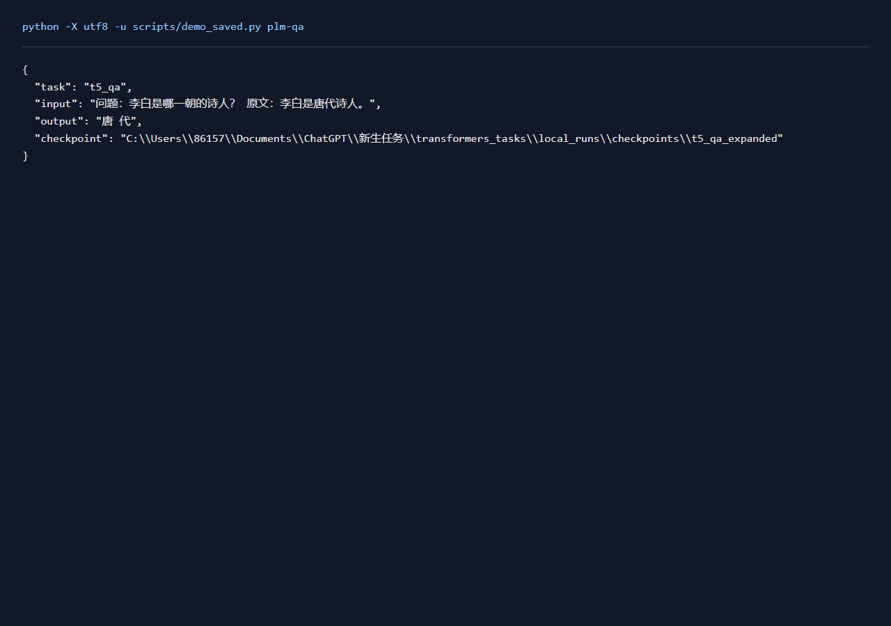
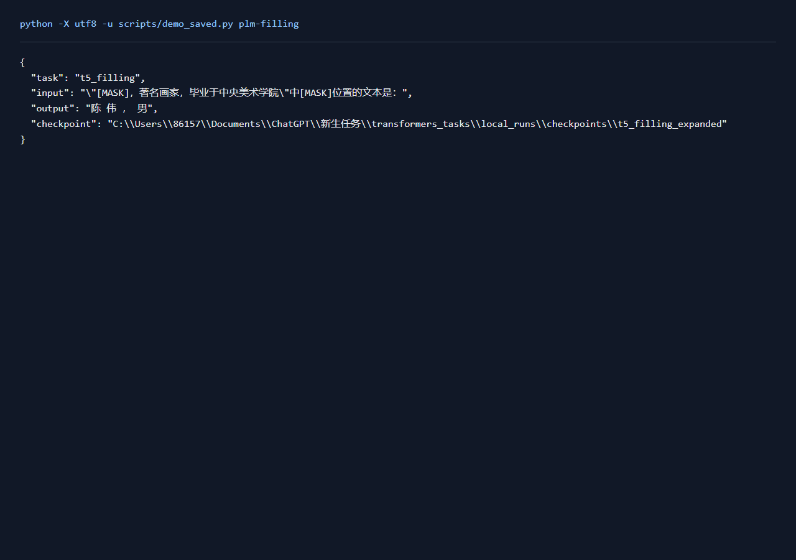

# T5生成实验报告

## 一、实验环境与条件

依赖与设备见[实验环境](实验环境.md)。下表中的训练数量、轮数和配置来自实际运行记录，默认种子42。

## 二、实验方法与过程

用中文T5-small完成问答与填空。保留1,000条训练的基线，新增5,000条训练、各500条验证与测试的实验。问答按context分组，填空按目标文本分组留出。输入上限192 token，目标上限64 token；训练采用teacher forcing，测试实际生成文本，计算完全匹配率与字符F1。

### 实现与知识点

T5编码器读取问题和上下文，解码器逐token生成答案。输入中的token_type_ids移除，标签padding设为-100。decoder_start_token使用CLS，训练目标只保留目标token和SEP。完全匹配评价完整答案，字符F1观察部分内容重叠；两者一起判断生成效果。

### 复现命令

```powershell
.\.venv\Scripts\python.exe transformers_tasks/local_runs/seq2seq_tasks.py qa --limit 5000 --epochs 8 --batch 8 --lr .0003 --eval-limit 500 --tag _expanded
.\.venv\Scripts\python.exe transformers_tasks/local_runs/seq2seq_tasks.py filling --limit 5000 --epochs 8 --batch 8 --lr .0003 --eval-limit 500 --tag _expanded
```

## 三、实验结果及分析

| 实验配置 | 训练规模 | 轮数 | 验证指标 | 测试指标 | 运行时间 / s |
|---|---:|---:|---|---|---:|
| [t5_filling_n1000_v2](../transformers_tasks/local_runs/results/t5_filling_n1000_v2.json) | 1000 | 10 | loss=4.0089 | loss=4.1071; exact_match=0.0300; character_f1=0.2577 | 179.0 |
| [t5_filling_n5000_v2_expanded](../transformers_tasks/local_runs/results/t5_filling_n5000_v2_expanded.json) | 5000 | 8 | loss=3.1771 | loss=3.1253; exact_match=0.0360; character_f1=0.2913 | 692.2 |
| [t5_qa_n1000_v2](../transformers_tasks/local_runs/results/t5_qa_n1000_v2.json) | 1000 | 10 | loss=2.3960 | loss=2.7285; exact_match=0.2700; character_f1=0.5462 | 212.0 |
| [t5_qa_n5000_v2_expanded](../transformers_tasks/local_runs/results/t5_qa_n5000_v2_expanded.json) | 5000 | 8 | loss=1.4798 | loss=1.3002; exact_match=0.3720; character_f1=0.6503 | 852.8 |


T5填空按验证集选择的配置为 `t5_filling_n5000_v2_expanded`，loss=3.1771，测试结果为 loss=3.1253; exact_match=0.0360; character_f1=0.2913。
T5问答按验证集选择的配置为 `t5_qa_n5000_v2_expanded`，loss=1.4798，测试结果为 loss=1.3002; exact_match=0.3720; character_f1=0.6503。









| 配置 | 测试样例 | 输入超过192 token | 目标超过64 token |
|---|---:|---:|---:|
| t5_qa_n1000_v2 | 100 | 66 | 0 |
| t5_qa_n5000_v2_expanded | 500 | 282 | 0 |
| t5_filling_n1000_v2 | 100 | 0 | 1 |
| t5_filling_n5000_v2_expanded | 500 | 0 | 3 |

上表用实际tokenizer统计长度。长上下文在当前输入窗口内保留前192 token，超长训练目标保留63个内容token及SEP；完全匹配率与字符F1仍对完整原始答案计算。长文本覆盖和目标长度会影响生成结果，错误样例与这些输入条件一起分析。

[实际输入长度统计](../运行记录/诊断/generation_lengths.json)

问答与填空分开评价。字符F1高于完全匹配率时，通常表示回答包含部分正确内容，但仍有遗漏或多余字符。新增实验扩大训练与留出评估，训练轮数、批量和学习率也随配置调整。基线各评价100条，新增实验各评价500条，表中差值反映整套训练与评价配置的变化。

**t5_filling_n1000_v2实际输出**

```json
[
  {
    "input": "\"刘备和诸葛亮[MASK]讲述的鱼水关系吗\"中[MASK]位置的文本是：",
    "gold": "真的是《三国演义》中",
    "prediction": "的 一 个 人 ， 是 一 个 人 的 一 个 人 ，"
  }
]
```

**t5_filling_n5000_v2_expanded实际输出**

```json
[
  {
    "input": "\"吕治国 [MASK]1952年6月出生，湖南石门人\"中[MASK]位置的文本是：",
    "gold": "男，土家族，",
    "prediction": "， 男 ，"
  }
]
```

**t5_qa_n1000_v2实际输出**

```json
[
  {
    "input": "问题：联通客服 原文：中国联通介绍: 中国联合网络通信集团有限公司(简称中国联通)于2009年1月6日在原中国网通和原中国联通的基础上合并而成,在国内31个省(自治区、直辖市)和境外多个国家和地区设有分支机构,是中国唯一一家同时在纽约、香港、上海三地上市的电信运营企业。 10010,是中国联通客户服务号码,通过\"10010\"、\"10011\"热线您可以得到多方位的客户服务,同时\"10018\"还可为联通俱乐部会员提供商旅、休闲等内容丰富的通信对信息服务。短信服务使用正确的编号发送至10010:101:当月话费102:可用余额104:历史账单201:信用额度0071:手机音乐0072:手机电视0073:手机邮箱",
    "gold": "10010",
    "prediction": "10008"
  }
]
```

**t5_qa_n5000_v2_expanded实际输出**

```json
[
  {
    "input": "问题：雅思班价格 原文：报雅思或者托付培训班,一般情况下要900元左右。 雅思和托福考试可以自学: 一、基础知识准备:单词、基本语法、长难句分析; 二、板块训练:听说读写,四个板块; 三、合理备考计划,可以参见中国上别人经验结合自己的自身条件; 四、效果强化跟踪,使用合理的备考软件或者是自测题目随时跟踪自己的学习状态",
    "gold": "900元",
    "prediction": "900 元 左 右"
  }
]
```

### 实际运行截图



[原始输出](运行截图/plm-qa.txt) · [执行记录](运行截图/plm-qa.json)

### 实际运行截图



[原始输出](运行截图/plm-filling.txt) · [执行记录](运行截图/plm-filling.json)

## 四、遇到的问题及处理情况

最初目标中重复加入CLS会造成生成起始符号异常，改为target+SEP后重新训练。填空文件过滤缺分隔符、空输入或空目标的记录，实际数量保存到parsing字段。训练和测试均使用修正后的编码规则。
