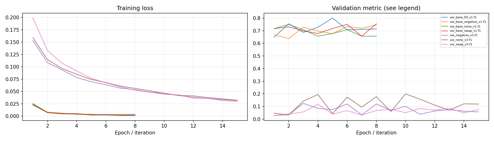
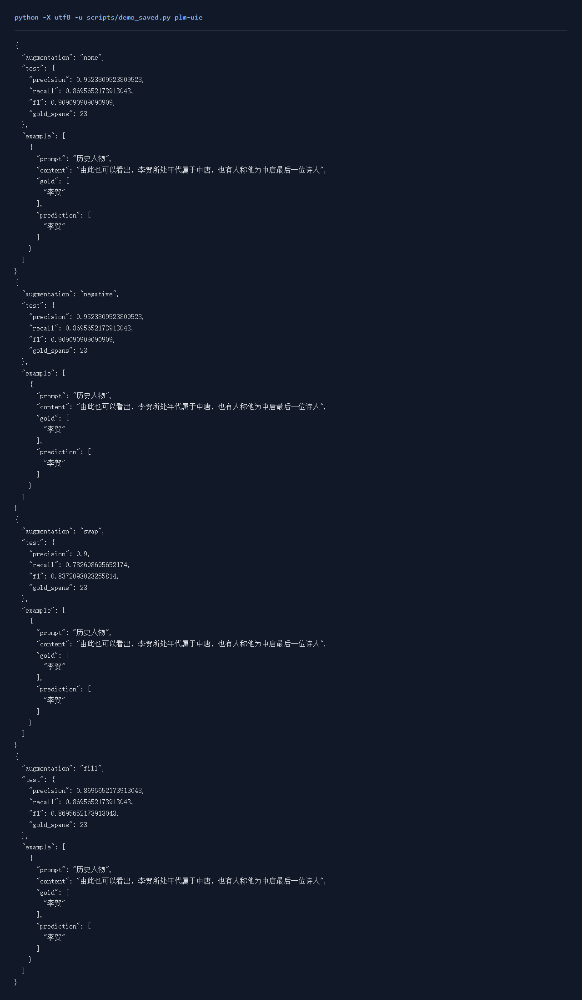

# 信息抽取实验报告

## 一、实验环境与条件

依赖与设备见[实验环境](实验环境.md)。下表中的训练数量、轮数和配置来自实际运行记录，默认种子42。

## 二、实验方法与过程

先以小BERT和边界头训练条件抽取，再加载上游Pky/uie-base-zh的预训练编码器与起止头进行对照。预训练UIE比较原始训练、已标注训练负例中的误报挖掘、SwapSPO及Mask Then Fill四组。SwapSPO按相同谓词分组，将一条样例的主体和客体共同放入另一条样例的上下文。Mask Then Fill调用5,000条训练的T5填空模型，保护所有已标注片段，替换其他片段并同步修正实体偏移；掩码左右各保留60个字符，保证输入中能看到掩码。候选按长度、重复片段和基础UIE抽取一致性筛选。

### 实现与知识点

输入由prompt和content组成，编码上限256 token。起点与终点用两个二分类头预测，损失屏蔽prompt、特殊符号和padding，只在content有效token上计算，正边界权重为10。字符标注通过offset_mapping转换为token位置，预测token再还原为字符区间，跨度最多40 token。阈值从0.3、0.5、0.7中按验证F1选择。增强数据只由训练记录生成，各组从相同预训练权重和随机种子开始。预训练组使用batch8、lr=2e-5训练8轮。

### 复现命令

```powershell
.\.venv\Scripts\python.exe transformers_tasks/local_runs/span_task.py --pretrained-uie --augment none --epochs 8 --batch 8 --lr .00002
.\.venv\Scripts\python.exe transformers_tasks/local_runs/span_task.py --pretrained-uie --augment negative --epochs 8 --batch 8 --lr .00002
.\.venv\Scripts\python.exe transformers_tasks/local_runs/span_task.py --pretrained-uie --augment swap --epochs 8 --batch 8 --lr .00002
.\.venv\Scripts\python.exe transformers_tasks/local_runs/span_task.py --pretrained-uie --augment fill --epochs 8 --batch 8 --lr .00002 --filling-checkpoint t5_filling_expanded
```

## 三、实验结果及分析

| 实验配置 | 训练规模 | 轮数 | 验证指标 | 测试指标 | 运行时间 / s |
|---|---:|---:|---|---|---:|
| [uie_base_fill_v1](../transformers_tasks/local_runs/results/uie_base_fill_v1.json) | 2174 | 8 | f1=0.8000 | f1=0.8696 | 522.3 |
| [uie_base_negative_v1](../transformers_tasks/local_runs/results/uie_base_negative_v1.json) | 2102 | 8 | f1=0.7458 | f1=0.9091 | 511.9 |
| [uie_base_none_v1](../transformers_tasks/local_runs/results/uie_base_none_v1.json) | 2087 | 8 | f1=0.7500 | f1=0.9091 | 502.2 |
| [uie_base_swap_v1](../transformers_tasks/local_runs/results/uie_base_swap_v1.json) | 2227 | 8 | f1=0.7541 | f1=0.8372 | 540.4 |
| [uie_negative_v3](../transformers_tasks/local_runs/results/uie_negative_v3.json) | 2194 | 15 | f1=0.1250 | f1=0.0000 | 54.9 |
| [uie_none_v3](../transformers_tasks/local_runs/results/uie_none_v3.json) | 2087 | 15 | f1=0.2000 | f1=0.3448 | 52.5 |
| [uie_swap_v3](../transformers_tasks/local_runs/results/uie_swap_v3.json) | 2427 | 15 | f1=0.1176 | f1=0.1463 | 65.5 |


小BERT边界抽取按验证集选择的配置为 `uie_none_v3`，f1=0.2000，测试结果为 f1=0.3448。
预训练UIE按验证集选择的配置为 `uie_base_fill_v1`，f1=0.8000，测试结果为 f1=0.8696。

### 训练曲线



| 初始化 / 增强 | Precision | Recall | F1 | 测试实体数 |
|---|---:|---:|---:|---:|
| uie_base_fill_v1 | 0.8696 | 0.8696 | 0.8696 | 23 |
| uie_base_negative_v1 | 0.9524 | 0.8696 | 0.9091 | 23 |
| uie_base_none_v1 | 0.9524 | 0.8696 | 0.9091 | 23 |
| uie_base_swap_v1 | 0.9000 | 0.7826 | 0.8372 | 23 |
| uie_negative_v3 | 0.0000 | 0.0000 | 0.0000 | 23 |
| uie_none_v3 | 0.8333 | 0.2174 | 0.3448 | 23 |
| uie_swap_v3 | 0.1667 | 0.1304 | 0.1463 | 23 |

两种初始化分别成组观察。小BERT的早期swap记录采用同prompt实体替换；预训练UIE组采用同时交换主体和客体的SwapSPO。每组列出precision、recall和F1，负例挖掘主要针对误报，正例增强主要改变训练覆盖。增强前后都使用固定的原始验证与测试内容。预训练UIE的初始参数也纳入验证选优，best_epoch=0表示保留初始模型，各组仍完成记录中的全部训练轮数。

[SwapSPO实际增强记录](../运行记录/quality/swap_spo_samples.json) · [Mask Then Fill实际生成与筛选记录](../运行记录/quality/mask_fill_samples.json)

填空生成146个候选，保留87个。其中55个因长度、空输出、重复或原样填回被筛除，4个因抽取结果改变被筛除。保留候选的实际例子：“次当选”填为“次成为”；“演员表”填为“导演：罗斯·罗斯”。填空有时会补出原文未提供的信息，筛选记录与增强后的测试指标一起用于观察目标实体保持情况和上下文噪声。

原始训练组的测试precision、recall、F1分别为0.9524、0.8696、0.9091，填空增强组为0.8696、0.8696、0.8696。增强后的变化需要同时结合误报和漏报观察，保留的候选数量与上下文质量也会影响这一结果。

**uie_base_fill_v1实际输出**

```json
[
  {
    "prompt": "历史人物",
    "content": "由此也可以看出，李贺所处年代属于中唐，也有人称他为中唐最后一位诗人",
    "gold": [
      "李贺"
    ],
    "prediction": [
      "李贺"
    ]
  }
]
```

**uie_base_negative_v1实际输出**

```json
[
  {
    "prompt": "历史人物",
    "content": "由此也可以看出，李贺所处年代属于中唐，也有人称他为中唐最后一位诗人",
    "gold": [
      "李贺"
    ],
    "prediction": [
      "李贺"
    ]
  }
]
```

**uie_base_none_v1实际输出**

```json
[
  {
    "prompt": "历史人物",
    "content": "由此也可以看出，李贺所处年代属于中唐，也有人称他为中唐最后一位诗人",
    "gold": [
      "李贺"
    ],
    "prediction": [
      "李贺"
    ]
  }
]
```

**uie_base_swap_v1实际输出**

```json
[
  {
    "prompt": "历史人物",
    "content": "由此也可以看出，李贺所处年代属于中唐，也有人称他为中唐最后一位诗人",
    "gold": [
      "李贺"
    ],
    "prediction": [
      "李贺"
    ]
  }
]
```

**uie_negative_v3实际输出**

```json
[
  {
    "prompt": "历史人物",
    "content": "由此也可以看出，李贺所处年代属于中唐，也有人称他为中唐最后一位诗人",
    "gold": [
      "李贺"
    ],
    "prediction": []
  }
]
```

**uie_none_v3实际输出**

```json
[
  {
    "prompt": "历史人物",
    "content": "由此也可以看出，李贺所处年代属于中唐，也有人称他为中唐最后一位诗人",
    "gold": [
      "李贺"
    ],
    "prediction": []
  }
]
```

**uie_swap_v3实际输出**

```json
[
  {
    "prompt": "历史人物",
    "content": "由此也可以看出，李贺所处年代属于中唐，也有人称他为中唐最后一位诗人",
    "gold": [
      "李贺"
    ],
    "prediction": []
  }
]
```

### 实际运行截图



[原始输出](运行截图/plm-uie.txt) · [执行记录](运行截图/plm-uie.json)

## 四、遇到的问题及处理情况

上游test为空，按content将dev分为验证和测试，并移除训练重复内容。UIE原始权重保存为旧版整模型对象，核对SHA-256后用受限读取器提取张量，转换为safetensors和现代配置。早期填空会出现重复人名、出生地等片段，长文本截断也可能丢失掩码；扩大填空训练后，改为掩码附近的局部上下文，限制重复生成，并用基础抽取模型检查增强前后的预测实体集合。增强样例的实体文本与偏移逐条核对。
