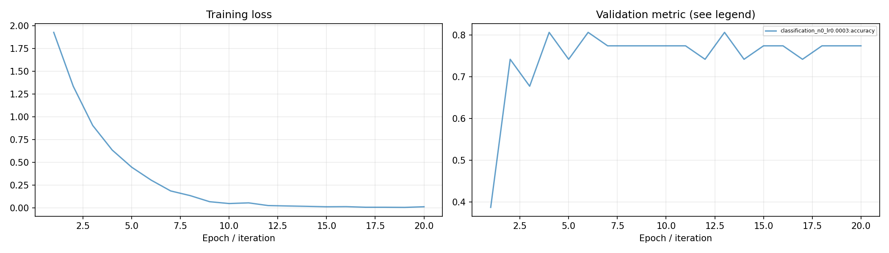

# 文本分类实验报告

## 一、实验环境与条件

依赖与设备见[实验环境](实验环境.md)。下表中的训练数量、轮数和配置来自实际运行记录，默认种子42。

## 二、实验方法与过程

使用中文小BERT的CLS表示接线性分类头，输入为上游评论分类数据，交叉熵训练20轮。验证集按macro-F1选优。

### 实现与知识点

CLS向量压缩了整句信息，分类头输出每个类别的logit。训练时backward计算梯度，AdamW更新参数；验证和预测使用eval模式。类别名称与上游label_mapping分别保存，方便查看数值标签与实际类别的对应关系。

### 复现命令

```powershell
.\.venv\Scripts\python.exe transformers_tasks/local_runs/bert_tasks.py classification --epochs 20
```

## 三、实验结果及分析

| 实验配置 | 训练规模 | 轮数 | 验证指标 | 测试指标 | 运行时间 / s |
|---|---:|---:|---|---|---:|
| [classification_n0_lr0.0003](../transformers_tasks/local_runs/results/classification_n0_lr0.0003.json) | 402 | 20 | macro_f1=0.7175 | accuracy=0.7188; macro_f1=0.7780 | 7.0 |


当前数据按验证集选择的配置为 `classification_n0_lr0.0003`，macro_f1=0.7175，测试结果为 accuracy=0.7188; macro_f1=0.7780。

### 训练曲线



### 实际运行截图


[原始输出](运行截图/plm-bert.txt) · [执行记录](运行截图/plm-bert.json)

## 四、遇到的问题及处理情况

Windows下分类标签显式转换为LongTensor。训练集与留出集使用固定划分，类别schema在配置中保存。
