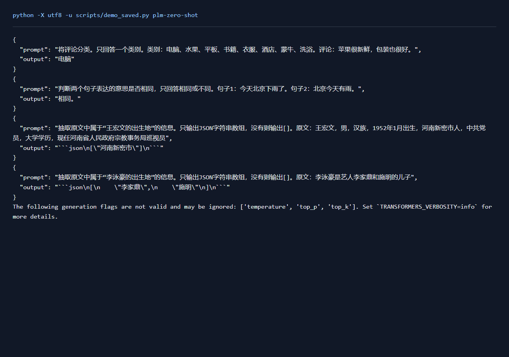
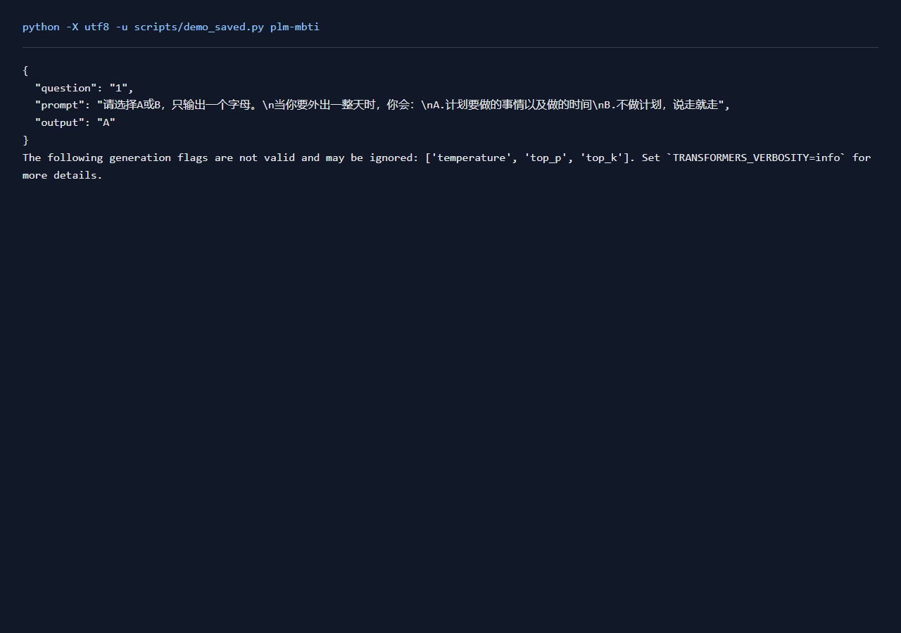

# 大模型应用实验报告

## 一、实验环境与条件

依赖与设备见[实验环境](实验环境.md)。下表中的训练数量、轮数和配置来自实际运行记录，默认种子42。

## 二、实验方法与过程

使用Qwen2.5-0.5B-Instruct进行零样本文本分类、文本匹配与条件抽取，提示提供类别schema和输出格式，不提供示例。新增评估最多100条每类留出记录，保存全部原始回答和解析结果。MBTI逐题生成A/B回答，并按上游维度映射计票。 条件抽取另比较三个提示模板，验证集分别采样正负例，按实体文字F1选优，再评价扩大实验中固定的100条测试记录。

### 实现与知识点

零样本任务依赖提示中的任务说明、类别含义与格式约定。类别标签通过上游label_mapping转换成可读名称。抽取使用JSON字符串数组，记录格式有效率和抽取准确率。MBTI输出按E/I、S/N、T/F、J/P分别统计，平票记问号，结果用于观察当前提示下的模型回答倾向。

### 复现命令

```powershell
.\.venv\Scripts\python.exe transformers_tasks/local_runs/llm_tasks.py zero-shot --eval-size 100 --tag _expanded
.\.venv\Scripts\python.exe transformers_tasks/local_runs/llm_tasks.py mbti
```
提示对照复现：`python scripts/zero_shot_prompt_study.py`，在扩大零样本实验完成后运行。


## 三、实验结果及分析

| 实验配置 | 训练规模 | 轮数 | 验证指标 | 测试指标 | 运行时间 / s |
|---|---:|---:|---|---|---:|
| [qwen_mbti](../transformers_tasks/local_runs/results/qwen_mbti.json) | — | — | — | — | 7.6 |
| [qwen_zero_shot_prompt_study](../transformers_tasks/local_runs/results/qwen_zero_shot_prompt_study.json) | 0 | — | f1=0.2276 | f1=0.0788 | 166.9 |
| [qwen_zero_shot_v2_expanded](../transformers_tasks/local_runs/results/qwen_zero_shot_v2_expanded.json) | — | — | — | — | 101.9 |


MBTI有效回答 93/93，计票 `{"J": 15, "S": 13, "E": 13, "F": 10, "I": 8, "P": 7, "N": 14, "T": 13}`，输出倾向为 `ENTJ`。
| 零样本任务 | 指标 | 样例数 |
|---|---|---:|
| extraction | `{"exact_set_accuracy": 0.02, "valid_json_rate": 1.0, "f1": 0.0788}` | 100 |

**extraction原始样例**

```json
[
  {
    "prompt": "李泳豪的出生地",
    "content": "李泳豪是艺人李家鼎和施明的儿子",
    "gold": [],
    "output": "```json\n[\n    \"李家鼎\",\n    \"施明\"\n]\n```",
    "prediction": [
      "李家鼎",
      "施明"
    ],
    "correct": false
  }
]
```

### 抽取提示对照

验证集固定取40条记录，按正例与负例分别采样。三个模板均提供任务说明与输出格式，few-shot示例数为0。模板按验证实体文字F1选择，平分时比较正负两组平均完全匹配率。

| 模板 | 验证Precision | 验证Recall | 验证F1 | 正例完全匹配率 | 负例完全匹配率 |
|---|---:|---:|---:|---:|---:|
| 原始条件prompt | 0.1373 | 0.6667 | 0.2276 | 0.2000 | 0.0000 |
| 主体与关系分列 | 0.0870 | 0.0952 | 0.0909 | 0.0500 | 0.0000 |
| 核对属性并筛除其他关系 | 0.1122 | 0.5238 | 0.1849 | 0.0500 | 0.0000 |

选中的模板为“原始条件prompt”。测试保持扩大实验的同100条记录，包含15条正例和85条负例。

| 测试配置 | 完全匹配率 | Precision | Recall | 实体文字F1 | 负例完全匹配率 |
|---|---:|---:|---:|---:|---:|
| 原始prompt | 0.0200 | 0.0430 | 0.4706 | 0.0788 | 0.0000 |
| 验证选优prompt | 0.0200 | 0.0430 | 0.4706 | 0.0788 | 0.0000 |

固定输出空数组在这批测试记录上的完全匹配率为0.8500，实体F1为0。结合两个指标观察正例识别与负例处理。这里按实体文字集合计分，同一文字去重，字符边界的严格匹配在UIE报告中另行评价。

[完整提示模板实现](../scripts/zero_shot_prompt_study.py)
| 零样本任务 | 指标 | 样例数 |
|---|---|---:|
| classification | `{"accuracy": 0.4062}` | 32 |
| matching | `{"accuracy": 0.69}` | 100 |
| extraction | `{"exact_set_accuracy": 0.02, "valid_json_rate": 1.0}` | 100 |

**classification原始样例**

```json
[
  {
    "input": "手感不错，用料也很好，不知道水洗后怎样，相信大品牌，质量过关，五星好评！！！",
    "gold": "衣服",
    "output": "电脑",
    "correct": false
  }
]
```

**matching原始样例**

```json
[
  {
    "a": "我的签名怎么写才好看",
    "b": "英语的字体怎么写的好看点。",
    "gold": 0,
    "output": "不同。",
    "prediction": 0,
    "correct": true
  }
]
```

**extraction原始样例**

```json
[
  {
    "prompt": "李泳豪的出生地",
    "content": "李泳豪是艺人李家鼎和施明的儿子",
    "gold": [],
    "output": "```json\n[\n    \"李家鼎\",\n    \"施明\"\n]\n```",
    "prediction": [
      "李家鼎",
      "施明"
    ],
    "correct": false
  }
]
```

分类错误结合原始评论、类别名称与模型回答逐条检查。抽取同时检查JSON格式和实体集合：可解析的回答仍可能包含其他关系的实体，两个指标分别反映格式遵循与内容识别。上面的样例直接来自本次留出评估，完整回答保存在对应JSON中。

### 输出与原文核对

在保存的原始回答上补做原文约束：保留文字确实出现在原文中的实体，JSON解析失败的回答维持原状态。该步骤只核对预测文字与输入，使用同一批100条记录。

| 配置 / 输出处理 | 完全匹配率 | Precision | Recall | 实体文字F1 |
|---|---:|---:|---:|---:|
| qwen_zero_shot_v2_expanded / 原始回答 | 0.0200 | 0.0430 | 0.4706 | 0.0788 |
| qwen_zero_shot_v2_expanded / 原文约束 | 0.2800 | 0.0556 | 0.4706 | 0.0994 |
| qwen_zero_shot_prompt_study / 原始回答 | 0.0200 | 0.0430 | 0.4706 | 0.0788 |
| qwen_zero_shot_prompt_study / 原文约束 | 0.2800 | 0.0556 | 0.4706 | 0.0994 |

扩大实验中共移除42个原文中没有的预测实体，实体召回率保持相同。原文中其他关系的实体仍可能被返回，因此还需结合prompt指定的主体与关系查看错误。三个提示模板的验证结果也保留在上表中，当前小模型更适合用来观察提示、输出格式和后处理的作用。

[逐条输出核对](../运行记录/诊断/zero_shot_output_checks.json) · [原文约束实现](../scripts/zero_shot_output_diagnostics.py)

### 实际运行截图



[原始输出](运行截图/plm-zero-shot.txt) · [执行记录](运行截图/plm-zero-shot.json)

### 实际运行截图



[原始输出](运行截图/plm-mbti.txt) · [执行记录](运行截图/plm-mbti.json)

## 四、遇到的问题及处理情况

模型从国内镜像和ModelScope恢复，并核对文件哈希。输出保留原文，解析失败计入评价。分类、匹配和抽取分别计分，避免格式正常掩盖内容错误。
