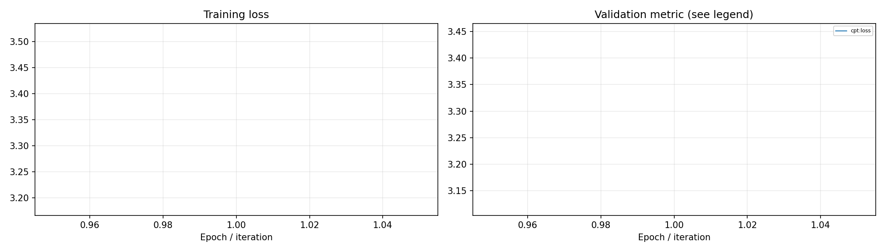
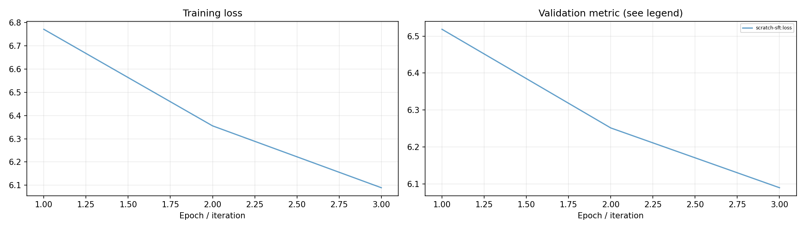
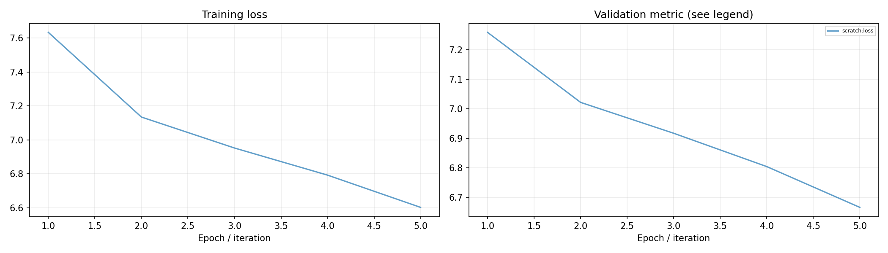
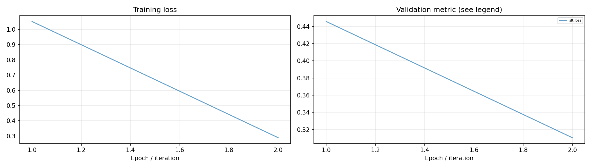
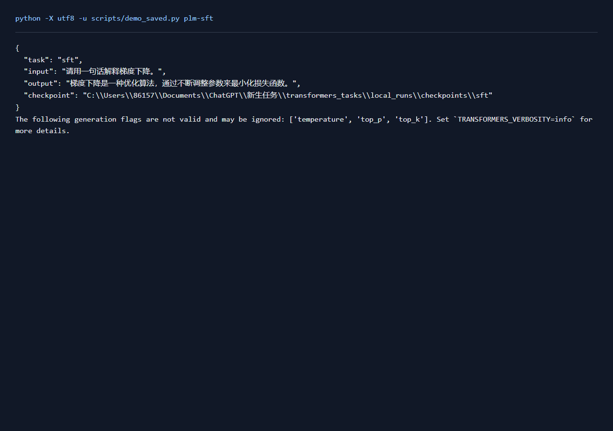
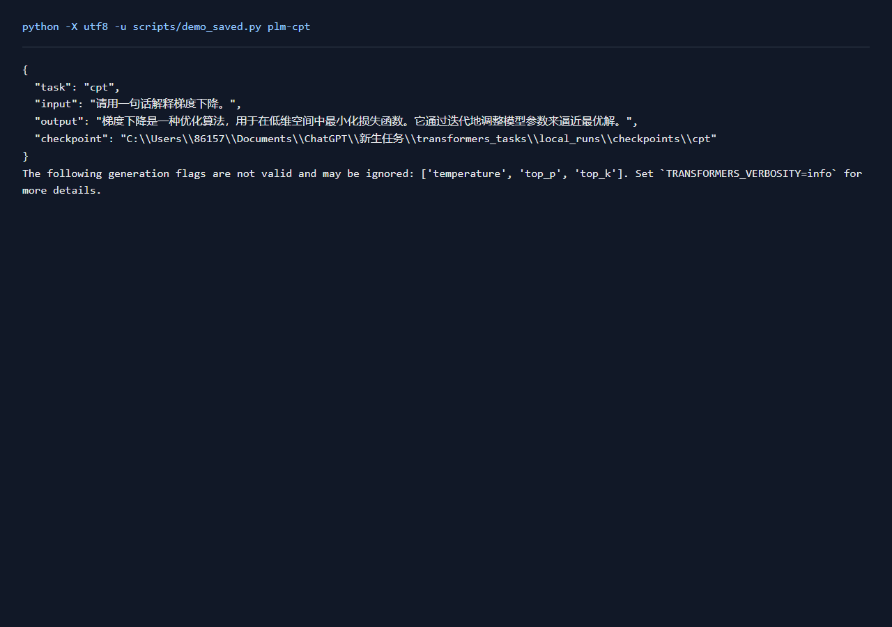
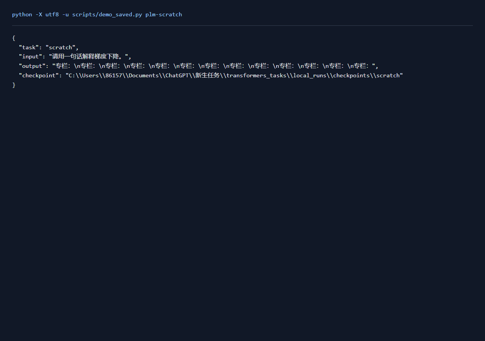
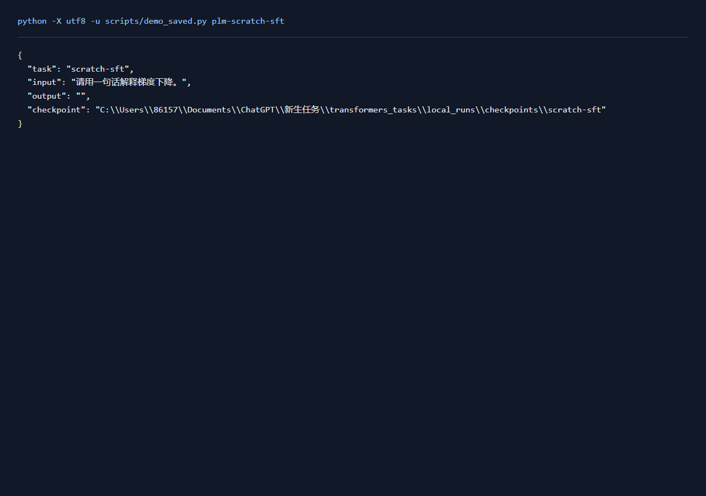

# 大模型训练实验报告

## 一、实验环境与条件

依赖与设备见[实验环境](实验环境.md)。下表中的训练数量、轮数和配置来自实际运行记录，默认种子42。

## 二、实验方法与过程

以Qwen 0.5B完成rank-8 LoRA指令微调和继续预训练。指令数据沿用ChatGLM目录的分类与抽取混合数据，训练400条、2轮；继续预训练使用MNBVC示例文档。另用训练文档拟合3,000词Byte-BPE，从随机参数训练4层、128维GPT2，再进行ShareGPT指令微调。

### 实现与知识点

LoRA冻结基座权重，训练低秩增量，q_proj和v_proj使用rank8、alpha16。指令微调仅对assistant目标计算损失，prompt与padding标签为-100；继续预训练对所有非padding token预测下一个token。从零模型先学习语言建模，再用对话学习回答格式。不同tokenizer下的困惑度分别观察。

### 复现命令

```powershell
.\.venv\Scripts\python.exe transformers_tasks/local_runs/llm_tasks.py sft --limit 400 --epochs 2
.\.venv\Scripts\python.exe transformers_tasks/local_runs/llm_tasks.py cpt --limit 400 --epochs 1
.\.venv\Scripts\python.exe transformers_tasks/local_runs/llm_tasks.py scratch --limit 1000 --epochs 5 --batch 8 --accumulate 1 --lr .0005
.\.venv\Scripts\python.exe transformers_tasks/local_runs/llm_tasks.py scratch-sft --limit 400 --epochs 3 --batch 8 --accumulate 1
```

## 三、实验结果及分析

| 实验配置 | 训练规模 | 轮数 | 验证指标 | 测试指标 | 运行时间 / s |
|---|---:|---:|---|---|---:|
| [cpt](../transformers_tasks/local_runs/results/cpt.json) | 200 | 1 | loss=3.2844 | loss=3.1278; perplexity=22.8239 | 55.4 |
| [scratch-sft](../transformers_tasks/local_runs/results/scratch-sft.json) | 400 | 3 | loss=6.0896 | loss=5.9943; perplexity=401.1337 | 4.3 |
| [scratch](../transformers_tasks/local_runs/results/scratch.json) | 200 | 5 | loss=6.6654 | loss=6.7755; perplexity=876.1420 | 3.0 |
| [sft](../transformers_tasks/local_runs/results/sft.json) | 400 | 2 | loss=0.3106 | loss=0.2817; perplexity=1.3254 | 202.6 |


GPT2指令微调按验证集选择的配置为 `scratch-sft`，loss=6.0896，测试结果为 loss=5.9943; perplexity=401.1337。
Qwen指令微调按验证集选择的配置为 `sft`，loss=0.3106，测试结果为 loss=0.2817; perplexity=1.3254。
Qwen继续预训练按验证集选择的配置为 `cpt`，loss=3.2844，测试结果为 loss=3.1278; perplexity=22.8239。
随机初始化GPT2按验证集选择的配置为 `scratch`，loss=6.6654，测试结果为 loss=6.7755; perplexity=876.1420。









**cpt实际输出**

```json
[
  {
    "input": "春天来了",
    "output": "春天，万物复苏的季节。在这个充满生机和希望的季节里，大自然开始换上新装，展现出它最美丽的面貌。春天的气息弥漫在空气中，仿佛能让人感受到生命的"
  }
]
```

**scratch-sft实际输出**

```json
[
  {
    "input": "Hola\\n\\n",
    "gold": "你好！今天有什么需要我帮助您的吗？",
    "output": ""
  }
]
```

**scratch实际输出**

```json
[
  {
    "input": "春天来了",
    "output": "专栏：\n\n专栏：\n专栏：\n专栏：\n专栏：\n专栏：\n专栏：\n专栏：\n专栏：\n专栏：\n专栏：\n专栏：\n专栏："
  }
]
```

**sft实际输出**

```json
[
  {
    "input": "Instruction: 你现在是一个很厉害的阅读理解器，严格按照人类指令进行回答。\nInput: 下面句子可能是一条关于什么的评论，用列表形式回答：\n\n差差差差差差差差\nAnswer: ",
    "gold": "[\"衣服\"]",
    "output": "[\"衣服\"]"
  }
]
```

### 实际运行截图



[原始输出](运行截图/plm-sft.txt) · [执行记录](运行截图/plm-sft.json)

### 实际运行截图



[原始输出](运行截图/plm-cpt.txt) · [执行记录](运行截图/plm-cpt.json)

### 实际运行截图



[原始输出](运行截图/plm-scratch.txt) · [执行记录](运行截图/plm-scratch.json)

### 实际运行截图



[原始输出](运行截图/plm-scratch-sft.txt) · [执行记录](运行截图/plm-scratch-sft.json)

## 四、遇到的问题及处理情况

4GB显存下使用BF16、LoRA、梯度累积和gradient checkpointing。长样本按保存的窗口规则截断。原6B/7B实验流程在本机以0.5B和小GPT2完成，模型规模、数据量和可训练参数写入结果配置。七类保存的生成模型均重新加载并实际预测。
