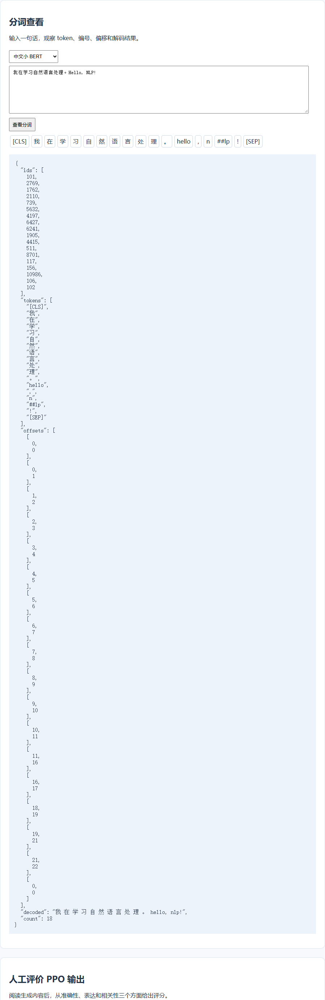

# 分词与评价工具实验报告

## 一、实验环境与条件

工具基于Python本地HTTP服务，监听127.0.0.1:8765，使用中文BERT、Qwen和自训练BPE分词器。

## 二、实验方法与过程

输入中英文、数字和标点，查看token、编号、字符偏移与decode。用同一输入比较不同分词器，读取PPO生成样例进行人工评价。

```powershell
.\.venv\Scripts\python.exe transformers_tasks/local_runs/local_tools.py
```

浏览器打开 http://127.0.0.1:8765 。

## 三、实验结果及分析

BERT主要按中文字符分词，Qwen和Byte-BPE按词表合并字节片段。可见token与字符数量可能不同，decode用于核对文本恢复。[接口检查](../运行记录/local_tools_checks.json)记录三个分词器及评分输入的检查结果。



## 四、遇到的问题及处理情况

字节BPE的token字符串会呈现字节编码形式，页面同时显示decode与offset，便于观察。评分保存范围为1至5，阅读者填入后追加到human_ratings.jsonl，原始生成内容同时保存。
