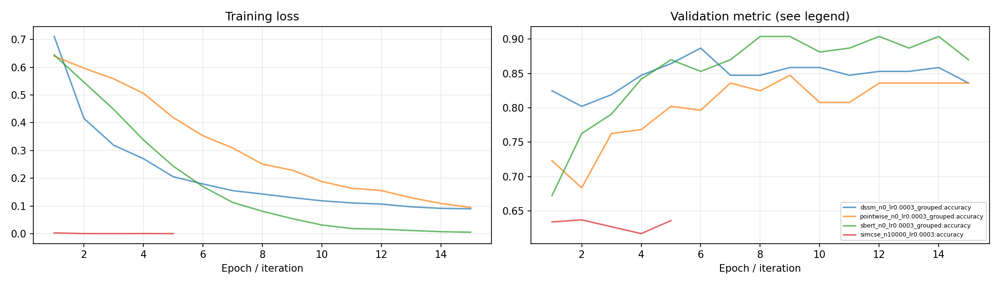
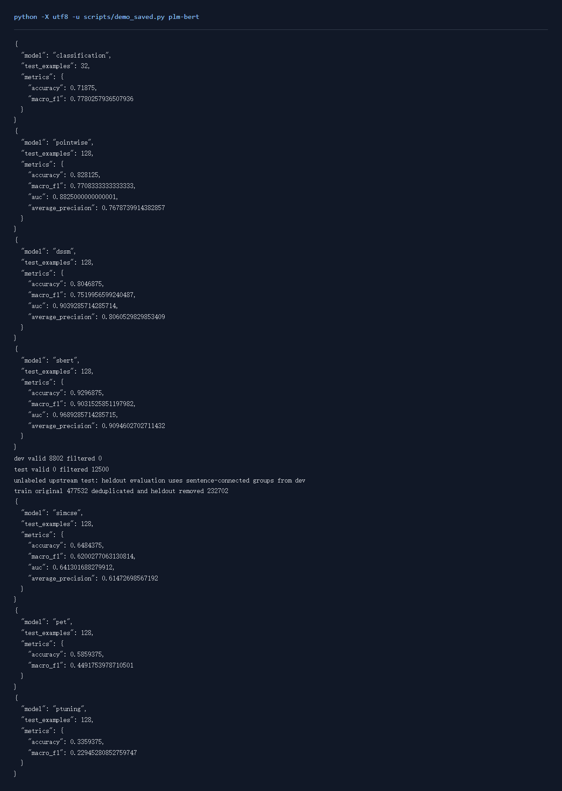

# 文本匹配实验报告

## 一、实验环境与条件

依赖与设备见[实验环境](实验环境.md)。下表中的训练数量、轮数和配置来自实际运行记录，默认种子42。

## 二、实验方法与过程

监督任务比较Pointwise、DSSM和Sentence-BERT。Pointwise将两句共同编码，双塔模型分别编码两句。上游评论与多个类别组成句对，dev/test按原评论分组。无监督SimCSE使用单句训练，每句话独立经过两次Dropout，同批其他句子作为负例。

### 实现与知识点

单塔适合精细判断文本交互；双塔可先计算并缓存候选向量，便于检索。SBERT分类头拼接u、v与abs(u-v)。SimCSE的InfoNCE将正对相似度与整批相似度比较，温度为0.05，训练阶段只用单句和Dropout视图。相似度阈值在验证集选择，测试时固定。

### 复现命令

```powershell
.\.venv\Scripts\python.exe transformers_tasks/local_runs/bert_tasks.py pointwise
.\.venv\Scripts\python.exe transformers_tasks/local_runs/bert_tasks.py dssm
.\.venv\Scripts\python.exe transformers_tasks/local_runs/bert_tasks.py sbert
.\.venv\Scripts\python.exe transformers_tasks/local_runs/bert_tasks.py simcse --limit 10000 --epochs 5
```

## 三、实验结果及分析

| 实验配置 | 训练规模 | 轮数 | 验证指标 | 测试指标 | 运行时间 / s |
|---|---:|---:|---|---|---:|
| [dssm_n0_lr0.0003_grouped](../transformers_tasks/local_runs/results/dssm_n0_lr0.0003_grouped.json) | 923 | 15 | macro_f1=0.8768 | accuracy=0.8229; macro_f1=0.7935; auc=0.9035; average_precision=0.8456 | 21.0 |
| [pointwise_n0_lr0.0003_grouped](../transformers_tasks/local_runs/results/pointwise_n0_lr0.0003_grouped.json) | 923 | 15 | macro_f1=0.8305 | accuracy=0.8286; macro_f1=0.7948; auc=0.9040; average_precision=0.8212 | 11.9 |
| [sbert_n0_lr0.0003_grouped](../transformers_tasks/local_runs/results/sbert_n0_lr0.0003_grouped.json) | 923 | 15 | macro_f1=0.8861 | accuracy=0.9143; macro_f1=0.8956; auc=0.9713; average_precision=0.9328 | 21.3 |
| [simcse_n10000_lr0.0003](../transformers_tasks/local_runs/results/simcse_n10000_lr0.0003.json) | 10000 | 5 | macro_f1=0.6171 | accuracy=0.6150; macro_f1=0.5949; auc=0.6465; average_precision=0.6109 | 58.8 |


SimCSE无监督划分按验证集选择的配置为 `simcse_n10000_lr0.0003`，macro_f1=0.6171，测试结果为 accuracy=0.6150; macro_f1=0.5949; auc=0.6465; average_precision=0.6109。
监督评论匹配按验证集选择的配置为 `sbert_n0_lr0.0003_grouped`，macro_f1=0.8861，测试结果为 accuracy=0.9143; macro_f1=0.8956; auc=0.9713; average_precision=0.9328。

### 训练曲线



### 实际运行截图



[原始输出](运行截图/plm-bert.txt) · [执行记录](运行截图/plm-bert.json)

## 四、遇到的问题及处理情况

LCQMC训练文件是单句，dev含标签，test没有标签。按照文件实际格式读取，将有标签dev按共享句子的连通组划成验证与测试，并清除训练文本重叠。
